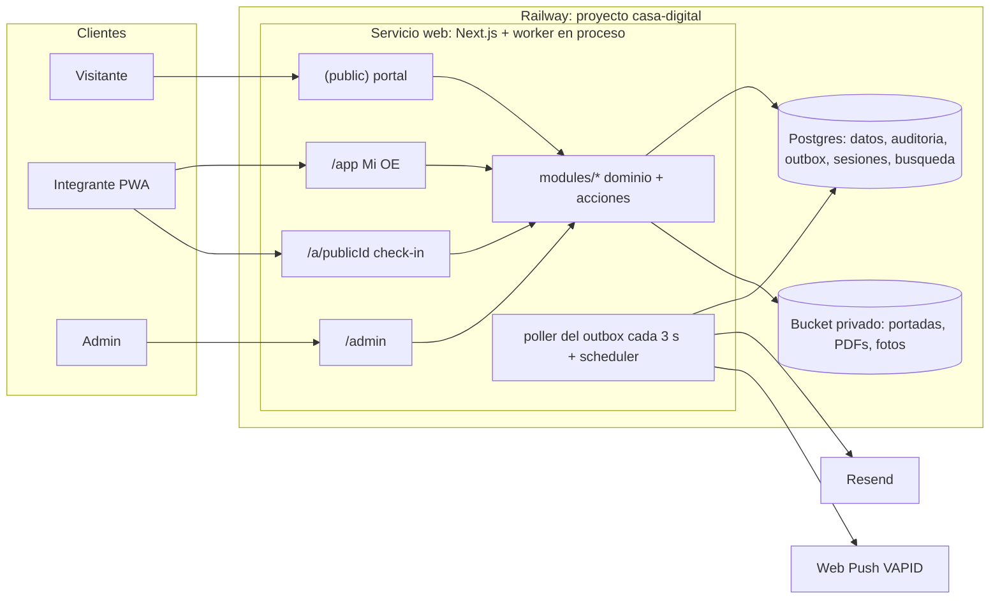

# Arquitectura

Monolito modular en **Next.js (App Router) + TypeScript + Prisma** desplegado como **un servicio en Railway**, con **PostgreSQL** y un **bucket privado** en el mismo proyecto. El trabajo de fondo sale por un outbox transaccional drenado por un poller que corre en el mismo proceso que la app. No hay Redis, colas de terceros ni servicios sueltos: todo vive en un panel. Hosting decidido en [ADR-021](adr/ADR-021-infraestructura-railway.md).

## Vista general



## Módulos

Cada módulo vive en `src/modules/<módulo>/` con `schema.prisma` (Prisma en modo carpeta `prisma/schema/`), `domain/` (comandos, lecturas y `*-pure.ts` sin I/O), `actions.ts` (server actions), `jobs.ts` (handlers de outbox y programados), `events.ts` y `components/`. Los módulos no se importan entre sí por dentro: se hablan por lecturas explícitas exportadas y por eventos de dominio.

| Módulo | Responsabilidad | Modelos principales |
| --- | --- | --- |
| `identity` | Acceso por OTP, sesiones, permisos técnicos, actor | `Session`, `OtpChallenge`, `Permission` |
| `people` | La persona como eje del CRM, ciclo de vida, comités por término, cargos, consentimiento | `Person`, `Membership`, `CommitteeMembership`, `Appointment`, `Consent`, `Committee` |
| `crm` | Organizaciones, contactos, pipelines, tarjetas, línea de tiempo, notas, tareas, etiquetas, segmentos | `Organization`, `OrganizationContact`, `Pipeline`, `PipelineStage`, `Card`, `Interaction`, `Task`, `Tag`, `Segment` |
| `forms` | Formularios propios (públicos y de integrantes), respuestas, inscripciones a ediciones | `Form`, `Submission`, `EditionRegistration` |
| `events` | Eventos permanentes, ediciones, comités organizadores, calendario ICS | `Event`, `EventEdition`, `EditionCommittee` |
| `participation` | Términos, ocasiones (actividad, asamblea, sesión de edición), check-ins, ledger, rankings, score de comité | `Term`, `Occasion`, `CheckIn`, `PointEntry`, `CommitteeParticipation`, `TermStanding`, `AssemblyRequirement` |
| `permanence` | La tabla de permanencia de GH y las de cada comité: reglas por término y ámbito, presupuestos, grupos de trabajo, evaluaciones y puntajes del líder, snapshot por persona, decisiones de cierre | `PermanenceRule`, `WorkGroup`, `WorkGroupMembership`, `PermanenceSnapshot`, `PermanenceDecision`, `ManualCredit` |
| `content` | Páginas editables, cartelera, medios, documentos de normativa, ficha editorial de comité | `Page`, `Announcement`, `MediaAsset`, `Document` |
| `comms` | Plantillas, campañas, mensajes, suscripciones push, preferencias | `EmailTemplate`, `Campaign`, `Message`, `PushSubscription`, `NotificationPreference` |
| `system` | Auditoría, configuración, outbox, importaciones, exportes, alias legados, salud | `AuditLog`, `AppConfig`, `Outbox`, `ImportJob`, `LegacyAlias` |

## Capas dentro de un request

| Capa | Dónde | Puede | No debe |
| --- | --- | --- | --- |
| Páginas RSC | `src/app/**` | Leer por las lecturas exportadas de cada módulo y renderizar | Consultar Prisma directamente |
| Componentes client | `src/modules/*/components`, `src/shared/ui` | Enviar `FormData` a server actions, transiciones de UI | Autorizar o calcular puntos |
| Proxy | `src/proxy.ts` | Redirigir rutas protegidas sin cookie, emitir CSP con nonce | Decidir roles o estados |
| Server actions | `src/modules/*/actions.ts` | Parsear con Zod, resolver el actor, llamar al dominio, revalidar | Reimplementar reglas |
| Dominio | `src/modules/*/domain` | Invariantes, transacciones, auditoría, outbox | Conocer cookies o Tailwind |
| Jobs | `src/modules/*/jobs.ts`, `src/jobs/` | Handlers idempotentes de outbox y programados | Tocar la base sin transacción o sin lock |
| Compartido | `src/shared/**`, `src/db/**` | Marca, UI base, admin kit, cliente Prisma, helpers puros | Lógica de negocio |

## Piezas transversales

- **Outbox transaccional con poller en proceso.** Cada comando escribe mutación, auditoría y eventos de dominio en la misma transacción (`src/db/tx.ts`). Un poller arrancado desde `instrumentation.ts` (cuando `JOBS_ENABLED=true`) toma cada 3 segundos hasta 50 filas pendientes con `FOR UPDATE SKIP LOCKED` y ejecuta sus handlers: push, correo, línea de tiempo, recomputes, revalidación. Reintentos con backoff y `deadLetterAt` visibles en `/admin/sistema/jobs`. Los recomputes usan `dedupeKey` (por ocasión) y `pg_advisory_xact_lock`, así una ráfaga de check-ins colapsa en un solo cálculo. `after()` de Next queda como optimización opcional para bajar la latencia de un check-in a menos de un segundo. Detalle en [ADR-012](adr/ADR-012-outbox-transaccional.md).
- **Programados.** Un scheduler en el mismo proceso (`croner`) encola filas de outbox según `src/jobs/schedule.ts`: `campaigns` cada minuto (lotes dentro del límite del proveedor), `reminders` cada hora, `prune` diario (sesiones, OTP, outbox procesado), `retention` mensual (anonimización de egresados), `backup-check` diario (verifica la última copia externa). Un lock transaccional por nombre evita duplicados si hay más de una réplica.
- **Eventos de dominio → línea de tiempo.** `checkin.approved`, `points.credited`, `membership.changed`, `stage.changed`, `submission.received`, `message.sent`, `card.moved` y `evaluation.recorded` producen `Interaction` en la persona; `permanence.recompute` recalcula el snapshot de permanencia. El CRM se alimenta solo.
- **Admin kit declarativo** (`src/shared/admin-kit/`): `defineResource({ modelo, columnas, filtros, formulario Zod, permisos })` genera listado paginado con búsqueda, ficha, crear/editar en panel lateral y export CSV. Cubre Comité, Término, Etiqueta, Organización, Formulario, Plantilla, Página, Documento, Anuncio y Pipeline. UI a medida solo para Persona 360, kanban, consola de ocasión, ledger, campañas e importaciones. Paleta de comandos (⌘K) con búsqueda `pg_trgm` sobre personas, organizaciones y ocasiones.
- **Marca** (`src/shared/brand/`): tokens, texturas, `Cartel`, elementos gráficos como SVG, tema claro/oscuro, movimiento reducido. Ver [07-marca.md](07-marca.md).
- **Adaptadores:** `Mailer` (`console` en desarrollo y `staging`; en producción Resend para transaccional con desbordamiento automático a SES desde 95 correos diarios, y SES para campañas), `Storage` (bucket de Railway vía S3; emulador local en desarrollo), `Pusher` (web-push con VAPID).

## Cómo corre en Railway

| Pieza | Configuración |
| --- | --- |
| Proyecto | `casa-digital`, nuevo, dentro del workspace Pro que ya paga GHPOINTS; misma región |
| Servicio `web` | Node 24, `npm run build`, `next start` en `0.0.0.0:$PORT`; healthcheck `GET /api/health` (timeout 300 s); pre-deploy `npm run db:release` (migraciones + uniques parciales + verificación, nunca seed); reinicio por fallo con hasta cinco reintentos; techos de 1 vCPU y 1 GB |
| Servicio `Postgres` | PostgreSQL 18 solo en red privada; volumen de 2 GB con alertas al 80 %, 95 % y 100 %; respaldos diario (6 días), semanal (1 mes) y mensual (3 meses); PITR |
| Bucket `media` | Privado, S3-compatible; variables enlazadas por referencia al servicio `web`; nunca `NEXT_PUBLIC_*`; CORS para el dominio de producción y los de PR o staging (`aws s3api put-bucket-cors`); sin snapshots nativos, por eso la copia mensual incluye sus objetos |
| Variables | `DATABASE_URL` por referencia a Postgres, `SESSION_SECRET`, `APP_URL`, `APP_TIMEZONE=America/Bogota`, `TZ=UTC`, `INSTITUTIONAL_EMAIL_DOMAINS`, `RESEND_API_KEY`, `EMAIL_FROM`, `VAPID_*`, `JOBS_ENABLED=true`, credenciales del bucket |
| Worker | En el mismo proceso del servicio `web`; un servicio `worker` aparte (misma imagen, `WORKER_ONLY=1`) solo con uso medido |
| Entornos | `staging` persistente desde la fase 0 (rama `main`, datos sintéticos, dominio de Railway o `pruebas.oeeafit.com` con `noindex`, correo a consola) y `production` desde la fase 7 (rama `production`, adelantada a mano desde `main`); entornos de PR apagados; desarrollo local con Postgres en Docker y emulador S3, sin credenciales de producción ([ADR-023](adr/ADR-023-operacion-entornos-respaldo-correo.md)) |
| Servicio `backup` | Cron de Railway el día 1 de cada mes (`0 8 1 * *`, 03:00 de Bogotá); `pg_dump` por la red privada más los objetos del bucket, cifrados con `age`, a un bucket privado de Cloudflare R2 (gratis); conserva 12 copias y termina |
| Dominio | `oeeafit.com` se mueve del servicio GHPOINTS al servicio `web` en el cutover |
| Límite de gasto | Límite duro del workspace revisado para dos apps en convivencia; alerta antes del tope |

Lo que este despliegue permite y que el diseño aprovecha:

- **Proceso permanente:** poller y scheduler en la app; sin crons externos ni funciones con tiempo máximo.
- **Medios sin pasar por la app:** subida directa del navegador al bucket con `POST` prefirmado y CORS; entrega por `/api/media/[id]`, que valida y redirige a una URL prefirmada, con egreso gratis desde el bucket ([ADR-022](adr/ADR-022-medios-prefirmados.md)).
- **Una sola región:** latencia desde Medellín de 60 a 90 ms, suficiente para este uso. Sin CDN delante por ahora: se revisaría solo ante spam en formularios públicos, lentitud medida o cargos de egreso.
- **Una sola instancia:** el healthcheck y los reinicios cubren fallos del proceso; la alta disponibilidad no es objetivo. Si algún día hace falta escalar, los locks transaccionales ya evitan trabajo duplicado.

## Layout del repositorio (cuando exista código)

```
casa-digital/
  railway.json                  build, start, healthcheck y pre-deploy
  prisma/schema/*.prisma        un archivo por módulo + migrations/ (incluye uniques parciales idempotentes)
  instrumentation.ts            arranca poller y scheduler cuando JOBS_ENABLED=true
  src/app/
    (public)/                   /  /la-oe  /cartelera  /eventos/[slug]/[edicion]  /comites/[slug]  /unirse  /f/[slug]  /privacidad
    app/                        inicio, eventos, comites, personas, gh-points, normativa, carnet, ajustes
    admin/                      personas, organizaciones, pipelines, formularios, comunidad, contenido, participacion, comunicaciones, sistema
    a/[publicId]/               check-in (sin sesión → /ingresar y vuelve)
    ingresar/                   OTP
    api/                        health, media/[id], media/presign, media/confirm, ics, push, export
  src/modules/<módulo>/         schema, domain, actions, jobs, events, components
  src/shared/                   brand, ui (shadcn base), admin-kit, lib
  src/db/                       cliente Prisma, tx + outbox, errores unique
  src/jobs/                     poller, scheduler, registro de handlers
  public/logos/                 oe.svg + 27 comités (hoy en ../public/logos)
  scripts/                      import-roster.ts, migrate-ghpoints.ts, verify-migration.ts, backup.ts
  tests/                        unit, integration (Postgres), e2e (Playwright)
```

## Infraestructura y costo

| Concepto | Costo |
| --- | --- |
| Railway Pro (workspace ya pagado por GHPOINTS; incluye US$20 de uso) | US$20/mes, ya en curso |
| Uso estimado de la app nueva: web 0,3 a 0,5 GB de RAM (US$3 a 5) + Postgres 0,1 a 0,2 GB (US$1 a 2) + volumen 1 GB (US$0,15) + bucket (US$0,015 por GB) | ≈ US$5 a 7, dentro de los US$20 incluidos |
| Uso de GHPOINTS durante la convivencia | ≈ US$4, también incluido |
| Entorno `staging` (web + Postgres + bucket con datos sintéticos) | ≈ US$3 a 4, también incluido |
| Servicio `backup` (corre minutos al mes) y Cloudflare R2 gratis (10 GB) | ≈ US$0 |
| Resend gratis (3.000 correos/mes, 100/día) para transaccional; SES (US$0,10 por 1.000) para desbordamiento y campañas | Centavos |
| Web push, dominio existente, fuentes sustitutas | US$0 |
| **Total esperado** | **US$20/mes, sin cambio** |
| Después del cutover | Se sigue en Pro (decidido el 2026-09-02): PITR y margen de uso para dos entornos |

## Alternativas evaluadas (2026-09-02)

| Opción | Costo real | Jobs de fondo | Postgres + bucket | Operación | Veredicto |
| --- | --- | --- | --- | --- | --- |
| **Railway, workspace Pro actual de GHPOINTS** | US$0 extra durante la convivencia; US$20 después | Worker en el mismo proceso | Incluidos, mismo panel, PITR ya configurado | Mínima, ya conocida | **Elegida** |
| Railway Hobby | ≈ US$5 a 7 | Igual | Incluidos, respaldos diarios | Mínima | Descartada: se sigue en Pro |
| Vercel + Neon + R2 | US$20 (Pro) o US$0 (Hobby con límites) | Sin proceso permanente: outbox + cron por minuto | Tres proveedores; Neon gratis se suspende al estar inactivo | Baja, más piezas | Elegida y descartada el mismo día: se prefirió lo que ya se paga ([ADR-019](adr/ADR-019-infraestructura-vercel-neon-r2.md), [ADR-021](adr/ADR-021-infraestructura-railway.md)) |
| Render | ≈ US$13 (web + Postgres) | Worker aparte cuesta otro servicio | Sin bucket propio | Baja | Descartada |
| Hetzner + Coolify | ≈ US$5 | Todo en una máquina | Vos instalás Postgres y MinIO | Alta: sos el sysadmin | Descartada |
| Fly.io (región Bogotá) | Variable | Máquinas permanentes | Postgres poco gestionado | Media-alta | Descartada: latencia mejor, más operación |
| Cloudflare completo (Workers + OpenNext, D1 o Postgres externo por Hyperdrive, R2, Queues, Cron Triggers) | ≈ US$5 a 10 | Queues, Cron Triggers y Durable Objects; sin proceso permanente | D1 es SQLite; Postgres solo externo; R2 incluido; el correo sigue afuera | Media-alta: Wrangler, bindings, sin módulos nativos como `sharp` | Descartada el 2026-09-02: obliga a rediseñar la capa de datos y el trabajo de fondo; ganaría latencia (≈ 15 ms) y WAF, que hoy no hacen falta |

## Seguridad transversal

- Cabeceras: `X-Content-Type-Options`, `X-Frame-Options`, `Referrer-Policy`, `Permissions-Policy`, `Strict-Transport-Security`; CSP en modo enforce con nonce por request desde el proxy.
- Redirecciones validadas (solo rutas same-origin), celdas de CSV/XLSX neutralizadas contra fórmulas, HTML de correos escapado.
- Secretos solo en variables de servidor; nunca `NEXT_PUBLIC_*` para claves; Postgres y bucket sin exposición pública.
- Auditoría en la misma transacción de cada mutación administrativa; exportes con datos personales exigen step-up (ver [05-acceso.md](05-acceso.md)).
