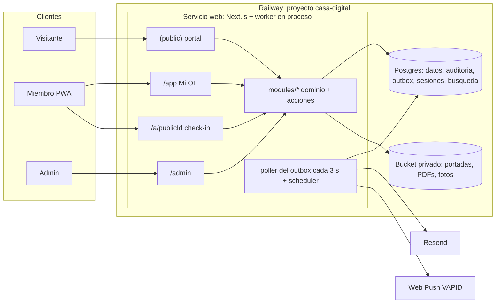

# Arquitectura

Monolito modular en **Next.js (App Router) + TypeScript + Drizzle** desplegado como **un servicio en Railway**, con **PostgreSQL** y un **bucket privado** en el mismo proyecto. El trabajo de fondo sale por un outbox transaccional drenado por un poller que corre en el mismo proceso que la app. No hay Redis, colas de terceros ni servicios sueltos: todo vive en un panel. Hosting decidido en [ADR-021](adr/ADR-021-infraestructura-railway.md); capa de datos en [ADR-032](adr/ADR-032-drizzle-y-esquema-por-modulo.md).

## Vista general



## Módulos

Cada módulo vive en `src/modules/<módulo>/` con `schema.ts` (sus tablas Drizzle; `drizzle.config.ts` las recoge), `domain/` (comandos, lecturas y `*-pure.ts` sin I/O), `actions.ts` (server actions), `jobs.ts` (handlers de outbox y programados), `events.ts`, `components/` e `index.ts` (su API pública). Los módulos no se importan entre sí por dentro: se hablan por lecturas explícitas exportadas desde `index.ts` y por eventos de dominio; `dependency-cruiser` lo verifica en `npm run check`. La única excepción es `schema.ts`: puede importar el `schema.ts` de otro módulo para declarar claves foráneas (referencias perezosas que Drizzle resuelve); los enums que comparten varios módulos viven en `src/db/enums.ts`.

| Módulo | Responsabilidad | Modelos principales |
| --- | --- | --- |
| `identity` | Acceso por OTP, sesiones, permisos técnicos, actor, token del calendario personal | `Session`, `OtpChallenge`, `Permission`, `CalendarToken`, `CarnetToken` |
| `people` | La persona como eje del CRM, ciclo de vida, comités por término, cargos asignados con capacidades por cargo ([ADR-058](adr/ADR-058-direccion-del-comite-por-areas.md)), consentimiento | `Person`, `Membership`, `CommitteeMembership`, `Appointment`, `Consent`, `Committee` |
| `crm` | Organizaciones, contactos, pipelines, tarjetas, solicitudes, convocatorias internas, línea de tiempo, notas, tareas, onboarding, reconocimientos; importa `people`, `terms`, `content`, `system` y, desde la fase 5, `forms` ([ADR-037](adr/ADR-037-admision-aliados-y-contactos-fase-5.md)) | `Organization`, `OrganizationContact`, `Pipeline`, `PipelineStage`, `Card`, `Request`, `InternalCall`, `InternalCallEntry`, `Interaction`, `Task`, `OnboardingProgress`, `Recognition` |
| `forms` | Formularios propios (públicos y de miembros), respuestas, inscripciones a ediciones; importa `people`, `events`, `system` y `terms`, nunca `crm` ([ADR-037](adr/ADR-037-admision-aliados-y-contactos-fase-5.md)) | `Form`, `Submission`, `EditionRegistration` |
| `events` | Eventos permanentes, ediciones, comités organizadores, calendario ICS | `Event`, `EventEdition`, `EditionCommittee` |
| `terms` | El término académico como reloj universal; no depende de ningún otro módulo ([ADR-035](adr/ADR-035-participacion-y-gh-points-fase-3.md)) | `Term` |
| `participation` | Ocasiones (actividad, asamblea, sesión de edición), check-ins, ledger, rankings, score de comité, requisito de asambleas, cierre de término, recordatorios y encuesta anónima tras la ocasión; desde la fase 6 importa `forms` ([ADR-038](adr/ADR-038-comunicaciones-y-pwa-fase-6.md)) | `Occasion`, `CheckIn`, `PointEntry`, `CommitteeParticipation`, `TermStanding`, `AssemblyRequirement`, `OccasionSurveyInvite`, `OccasionSurveyResponse` |
| `permanence` | La tabla de permanencia de GH y las de cada comité: reglas por término y ámbito con bloqueo por tabla, grupos de trabajo con evaluadores, evaluaciones, puntajes del líder y créditos manuales, snapshot por persona, propuestas y decisiones de cierre, panel de la junta; importa `terms`, `people`, `participation`, `system` y `events`, nadie lo importa ([ADR-036](adr/ADR-036-permanencia-fase-4.md)) | `PermanenceRule`, `PermanenceTable`, `WorkGroup`, `WorkGroupEvaluator`, `WorkGroupMembership`, `LeaderScore`, `ManualCredit`, `PermanenceSnapshot`, `PermanenceDecision` |
| `content` | Páginas editables, cartelera, medios, documentos de normativa, ficha editorial de comité | `Page`, `Announcement`, `MediaAsset`, `Document` |
| `comms` | Bus de notificaciones (push por preferencia, un `Message` por persona), suscripciones push y preferencias, plantillas de correo y campañas por segmento en lotes, registro de mensajes; importa `people`, `terms`, `content`, `participation` y `system`, nadie lo importa ([ADR-038](adr/ADR-038-comunicaciones-y-pwa-fase-6.md)) | `EmailTemplate`, `Campaign`, `CampaignRecipient`, `Message`, `PushSubscription`, `NotificationPreference` |
| `system` | Auditoría, configuración, outbox, importaciones, exportes, alias legados, salud | `AuditLog`, `AppConfig`, `Outbox`, `ImportJob`, `LegacyAlias` |
| `wallet` | Carnet opcional en Apple y Google Wallet, reservas y estados, sincronización/supresión de Google y conciliación diaria; importa `identity`, `people` y `terms` por API pública ([ADR-040](adr/ADR-040-carnet-en-billeteras-fase-8.md)) | `WalletPass` |
| `finance` | Presupuesto anual de cada comité: rubros, gastos y traslados entre rubros; importa `people`, `terms` y `system` ([ADR-059](adr/ADR-059-presupuesto-del-comite.md)) | `CommitteeBudget`, `BudgetLine`, `BudgetExpense`, `BudgetTransfer` |

## Capas dentro de un request

| Capa | Dónde | Puede | No debe |
| --- | --- | --- | --- |
| Páginas RSC | `src/app/**` | Leer por las lecturas exportadas de cada módulo y renderizar | Consultar la base directamente |
| Componentes client | `src/modules/*/components`, `src/shared/ui` | Enviar `FormData` a server actions, transiciones de UI | Autorizar o calcular puntos |
| Proxy | `src/proxy.ts` | Redirigir rutas protegidas sin cookie, emitir CSP con nonce | Decidir roles o estados |
| Server actions | `src/modules/*/actions.ts` | Parsear con Zod, resolver el actor, llamar al dominio, revalidar | Reimplementar reglas |
| Dominio | `src/modules/*/domain` | Invariantes, transacciones, auditoría, outbox | Conocer cookies o Tailwind |
| Jobs | `src/modules/*/jobs.ts`, `src/jobs/` | Handlers idempotentes de outbox y programados | Tocar la base sin transacción o sin lock |
| Compartido | `src/shared/**`, `src/db/**` | Marca, UI base, admin kit, cliente de base de datos, helpers puros | Lógica de negocio |

## Piezas transversales

**Wordle diario (ADR-041).** `participation` incorpora `WordleGame` y `WordleAttempt`, diccionario versionado solo servidor y crédito `WORDLE` del ledger. `/app/gh-points` compone la lectura pública y las acciones autenticadas con el tablero client. `wordle.completed` alimenta la línea de tiempo de CRM sin enviar notificaciones. El guard público `terms.lockOpenTermPoints` recibe la transacción existente: escrituras con bloqueo compartido del término, cierre con exclusividad y agregados dentro de esa misma transacción; así una victoria queda dentro del snapshot o se rechaza. `people.getMembershipRef` admite executor para comprobar la elegibilidad sin otra conexión del pool. Las versiones y reglas del diccionario se documentan en [ADR-041](adr/ADR-041-wordle-diario-y-cierre-de-puntos.md).

- **Outbox transaccional con poller en proceso.** Cada comando escribe mutación, auditoría y eventos de dominio en la misma transacción (`src/db/tx.ts`). Un poller arrancado desde `instrumentation.ts` (cuando `JOBS_ENABLED=true`) toma cada 3 segundos hasta 50 filas pendientes con `FOR UPDATE SKIP LOCKED` y ejecuta sus handlers: push, correo, línea de tiempo, recomputes, revalidación. Reintentos con backoff y `deadLetterAt` visibles en `/admin/sistema/jobs`. Los recomputes usan `dedupeKey` (por ocasión) y `pg_advisory_xact_lock`, así una ráfaga de check-ins colapsa en un solo cálculo. `after()` de Next queda como optimización opcional para bajar la latencia de un check-in a menos de un segundo. Detalle en [ADR-012](adr/ADR-012-outbox-transaccional.md).
- **Programados.** Un scheduler en el mismo proceso (`croner`) encola filas de outbox según `src/jobs/schedule.ts`: `campaigns` cada minuto (`comms.campaign-tick`: arranca las campañas programadas vencidas y manda un lote de `campaigns.perMinute` correos), `reminders` cada hora (cierra las ocasiones con ventana vencida, avisa si falta crear el término siguiente y, desde la fase 6, `participation.reminders` manda los recordatorios de hoy, de la víspera y de las asambleas), `permanence` diario a las 06:00 (recalcula la permanencia del término actual para que "lo que aún es posible" envejezca), `notices` diario a las 09:00 (`permanence.notices` manda por push los avisos de permanencia), `prune` diario (sesiones, OTP, outbox procesado), `backup-check` diario (verifica la última copia externa). No hay job de anonimización: la depuración ocurre en el comando de salida ([ADR-030](adr/ADR-030-perfil-de-egresado.md)). Un lock transaccional por nombre evita duplicados si hay más de una réplica.
- **Eventos de dominio → línea de tiempo.** `person.imported`, `person.updated`, `person.email-changed`, `membership.changed`, `committee-membership.changed`, `appointment.changed`, `consent.changed`, `person.deletion-requested`, `person.anonymized`, `person.data-exported`, `permission.granted` y `permission.revoked` (fase 2, [ADR-034](adr/ADR-034-personas-y-mi-oe-fase-2.md)) y, desde la fase 3 ([ADR-035](adr/ADR-035-participacion-y-gh-points-fase-3.md)), `checkin.approved`, `checkin.cancelled` y `points.adjusted` producen `Interaction` en la persona (con payloads autosuficientes: `crm` no consulta `participation`), `score.recompute` recalcula el score de la ocasión con clave por ocasión, `occasion.closed` y `term.points-closed` quedan para quien los necesite y `term.successor-missing` abre una tarea; desde la fase 4 ([ADR-036](adr/ADR-036-permanencia-fase-4.md)) `evaluation.recorded`, `leader-score.recorded`, `manual-credit.granted`, `work-group-membership.changed` y `permanence.decided` producen `Interaction` (y una evaluación buena de una tarea de nuevos marca el paso del onboarding), `permanence.recompute` recalcula el snapshot con clave por término o por persona y lock por término (lo encolan los comandos de `permanence` y sus handlers de `checkin.approved`, `checkin.cancelled`, `committee-membership.changed`, `membership.changed`, `person.imported` y `occasion.closed`), y `permanence.closed` dispara `permanence.apply-decisions`, el job reanudable que ejecuta las decisiones del cierre con comandos de `people`; desde la fase 5 ([ADR-037](adr/ADR-037-admision-aliados-y-contactos-fase-5.md)) `submission.received`, `registration.created`, `card.created`, `card.moved`, `stage.changed`, `person.admitted`, `request.created`, `request.decided` y `call-entry.changed` producen `Interaction` (en la persona o en la organización), `submission.received` crea además la tarjeta del pipeline declarado en el formulario, `call-entry.changed` con estado aceptado crea la pertenencia al grupo de trabajo en `permanence`, y `person.admitted` y `request.decided` envían los correos T-200 y T-205 desde `comms`; desde la fase 6 ([ADR-038](adr/ADR-038-comunicaciones-y-pwa-fase-6.md)) todo aviso a personas viaja por `notification.requested` (destinatarios, textos, URL y `dedupeKey`) y lo entrega `comms` por push según la preferencia de cada quien: lo emiten `content` al pedir el push de un anuncio (`announcement.push-requested`, que `comms` traduce resolviendo la audiencia), `participation` en los recordatorios y al cerrar una ocasión con encuesta, `permanence` en los avisos diarios, y el propio `comms` al escuchar `checkin.approved` (T-181), `request.decided` (T-189), `call.opened` (T-190) y `recognition.granted` (T-192); `permanence.decided` produce el correo T-202 cuando la persona cumple. Un evento puede tener varios handlers (uno por módulo interesado) y cada handler es idempotente; así `identity` limpia sesiones y permisos del mismo `membership.changed` que `crm` anota. El CRM se alimenta solo y los módulos no se conocen.
- **Admin kit declarativo** (`src/shared/admin-kit/`): `defineResource({ modelo, columnas, filtros, formulario Zod, permisos })` genera listado paginado con búsqueda, ficha, crear/editar en panel lateral y export CSV. Cubre Comité, Término, Etiqueta, Organización, Formulario, Plantilla, Página, Documento, Anuncio, Pipeline y Convocatoria. UI a medida solo para Persona 360, constructor de formularios, detalle de organización, kanban, bandeja de solicitudes, detalle de convocatoria, consola de ocasión, ledger, campañas e importaciones. Paleta de comandos (⌘K) con búsqueda `pg_trgm` sobre personas, comités, organizaciones y ocasiones.
- **Marca** (`src/shared/brand/`): tokens, texturas, `Cartel`, elementos gráficos como SVG, tema claro/oscuro, movimiento reducido. Ver [07-marca.md](07-marca.md).
- **Adaptadores:** `Mailer` (`console` en desarrollo y `staging`; en producción Resend para transaccional y campañas, con reintento de ráfagas; SES queda apagado sin `AWS_REGION` hasta otra fase (ADR-039); cabeceras `List-Unsubscribe` en campañas), `Storage` (bucket de Railway vía S3; Garage como emulador local), `Pusher` (web-push con VAPID; sin claves configuradas el envío se imprime en consola y se registra igual).
- **Billeteras (fase 8).** `wallet` compone nombre, comités y semestre de `people`/`terms` con el token `oe2` de `identity`; adaptadores `apple-pass` (firma `.pkpass`) y `google-wallet` (OAuth2/JWT/REST). El carnet `oe1` de Mi OE permanece. Las rutas requieren Node y sesión; secretos e imágenes privadas no llegan al navegador. Reserva local antes de crear Google, snapshots de generación/revisión/término y dos locks separan mutaciones breves de llamadas remotas. Los eventos fuente encolan `wallet.sync` por evento/persona; relee estado vigente y conserva las limpiezas sin credenciales. Un scheduler a las 00:05 de Bogotá recorre en lotes de 100 los pases Google y pendientes para el cambio de semestre. Apple se reemite a petición; no hay APNs. Ver [ADR-040](adr/ADR-040-carnet-en-billeteras-fase-8.md).
- **PWA:** `src/app/manifest.ts` sirve el manifest (`start_url` `/app`, iconos generados desde el isotipo por `scripts/pwa-icons.ts`), `public/sw.js` es un service worker propio que solo recibe el push, muestra la notificación y abre la URL (sin caché sin señal), y lo registra Mi OE; el portal público no lo registra ([ADR-038](adr/ADR-038-comunicaciones-y-pwa-fase-6.md)).

El control administrativo de política se ubica en `/admin/sistema/politica`, con navegación **Política de datos**. Un ADMIN publica primero la página `privacidad` con audiencia PUBLIC, estado PUBLISHED y cuerpo no vacío desde Páginas, revisa `/privacidad` y guarda la versión mediante step-up. La Server Action consulta las APIs públicas de `content` y `system`: comprueba la página antes de activar y escribe la configuración con auditoría `config.updated`. `system` conserva su guard por versión y no depende de `content`. Volver a `pendiente` bloquea nuevas aceptaciones sin editar la página ni borrar consentimientos previos. El control está desplegado y verificado en producción con 853d622; el texto real de la política y su habilitación siguen pendientes.

## Cómo corre en Railway

| Pieza | Configuración |
| --- | --- |
| Proyecto | `casa-digital`, nuevo, en el workspace Pro existente; región `us-east4-eqdc4a`; IaC en `.railway/railway.ts` (ADR-039) |
| Servicio `web` | Node 24, una réplica, `PORT=8080`, build/start y pre-deploy `npm run db:release` sin `.env` local ni seed; `/api/health` con timeout 300 s; límite 1 vCPU/1 GB, sin sleep; CI antes del despliegue |
| Servicio `Postgres` | PostgreSQL 18 en red privada, límite 1 vCPU/1 GB; volumen y respaldo diario/semanal/mensual más PITR verificados en F7-T2/T4 |
| Buckets PITR | `Postgres-PITR` en staging y `Postgres-PITR-production` en producción: nombres únicos a nivel del proyecto. Habilitar PITR antes del primer apply completo, asignar el nombre correspondiente conservando ID/contenido y adoptar en IaC; nunca aplicar un plan que borre el archivo |
| Bucket `media` | Privado por entorno, virtual-hosted (`S3_FORCE_PATH_STYLE=false`); CSP con origen efectivo del bucket; CORS mediante `storage:init` |
| Variables | `DATABASE_URL` y bucket por referencia; secretos por entorno; `TZ=UTC`, `APP_TIMEZONE=America/Bogota`, `JOBS_ENABLED=true`; `PUBLIC_INDEXING` false staging/true production; Resend solo producción, AWS ausente |
| Worker | Poller y scheduler en el proceso web; incluye conciliación Wallet diaria a las 00:05 de Bogotá; worker separado solo con uso medido |
| Wallet opcional | Apple: Pass Type ID, Team ID, certificado/clave base64 y contraseña opcional; Google: issuer, correo/clave base64 y sufijo por entorno. IaC preserva variables adoptadas; el sufijo Google por sí solo no habilita la plataforma; sin credenciales no emite y conserva limpiezas pendientes. Activación separada con política y prueba en dispositivo (ADR-040) |
| Entornos | Solo staging (main, datos sintéticos, dominio Railway, noindex) y production (rama production promovida a mano, datos nuevos). No hay ensayo ni entornos PR |
| Primer ADMIN | Script privado `bootstrap-admin`: persona, membresía ACTIVE y ADMIN con auditoría y transacción; sin comités, consentimiento ni bienvenida. Política y roster se cargan después desde el admin |
| Política pendiente | Nueva autorización rechazada mientras la versión siga pendiente; revocaciones, acceso y check-in continúan. Publicar texto desde Páginas y activar la versión en Política de datos (ADR-039, control verificado en producción) |
| Servicio `backup` | `docker/backup/Dockerfile` y `scripts/backup.sh`, cron `0 8 1 * *`; dump, objetos y manifiesto cifrados con age a R2; verificación de subida, retención de 12 totales manuales+cron y marca de éxito al final |
| Dominio | oeeafit.com se mueve al final; Cloudflare mantiene proxy, SSL Full, DNSSEC y www. Sin despliegue dentro de la ventana; conciliación del IaC después |
| Límite de gasto | Tope duro US$20 y alerta US$15, comprobados antes de crear recursos; no se aumenta automáticamente |


Lo que este despliegue permite y que el diseño aprovecha:

- **Proceso permanente:** poller y scheduler en la app; sin crons externos ni funciones con tiempo máximo.
- **Medios sin pasar por la app:** subida directa del navegador al bucket con `POST` prefirmado y CORS; entrega por `/api/media/[id]`, que valida y redirige a una URL prefirmada, con egreso gratis desde el bucket ([ADR-022](adr/ADR-022-medios-prefirmados.md)).
- **Una sola región:** latencia desde Medellín de 60 a 90 ms, suficiente para este uso. Cloudflare ya está delante del dominio: proxy activo, SSL Full, DNSSEC y regla www conservados (ADR-039).
- **Una sola instancia:** el healthcheck y los reinicios cubren fallos del proceso; la alta disponibilidad no es objetivo. Si algún día hace falta escalar, los locks transaccionales ya evitan trabajo duplicado.

## Layout del repositorio

```
casa-digital/
  .railway/railway.ts            IaC: entornos, servicios, referencias y despliegue
  docker/backup/Dockerfile       imagen del cron de copia externa
  scripts/backup.sh             dump, medios, cifrado, retención y marca de éxito
  scripts/wallet-assets.ts      genera PNG de Apple y logo Google 1024 desde la marca
  scripts/wallet-check.ts       diagnóstico local de configuración y fixtures, sin emisión
  scripts/smoke.ts              comprobaciones HTTP tras cada release
  scripts/bootstrap-admin.ts    primer acceso real y auditado, sin seed ni consentimiento
  compose.yaml                  Postgres 18 (127.0.0.1:5433) y Garage (127.0.0.1:3900) para OrbStack
  drizzle.config.ts             recoge src/modules/*/schema.ts; migraciones SQL en drizzle/
  drizzle/                      migraciones generadas y custom (pg_trgm)
  biome.json                    lint y formato; .dependency-cruiser.cjs vigila las fronteras entre módulos
  instrumentation.ts            arranca poller y scheduler cuando JOBS_ENABLED=true
  src/env.ts                    variables de entorno validadas con Zod al arrancar
  src/app/
    (public)/                   /  /la-oe  /cartelera  /eventos/[slug]/[edicion]  /comites/[slug]  /unirse  /f/[slug]  /privacidad
    app/                        inicio, cartelera/[id], comites, personas, egresados, gh-points, permanencia, solicitudes, convocatorias, encuesta/[token], normativa, carnet, ajustes
    admin/                      personas, organizaciones, pipelines, solicitudes, convocatorias, formularios, comunidad, contenido, participacion, permanencia, junta, plantillas, campanas, mensajes, sistema
    a/[publicId]/               check-in (sin sesión → /ingresar y vuelve)
    asamblea/[publicId]/        alias legado de GHPOINTS → /a/[publicId]
    baja/[token]/               baja de campañas por correo, sin sesión
    ingresar/                   OTP
    manifest.ts                 /manifest.webmanifest de la PWA
    api/                        health, media/[id], media/presign, media/confirm, documentos, mis-datos, admin/importaciones, ocasiones/[id]/live, ics (publico, mi-agenda), push/subscribe, baja/[token], export
  src/modules/<módulo>/         schema.ts, domain, actions, jobs, events, components, index.ts (API pública)
  src/shared/                   brand, ui (shadcn base), admin-kit, adapters, copy, log, lib
  src/db/                       cliente Drizzle sobre pg, tx + auditoría + outbox, errores unique
  src/jobs/                     poller, scheduler, registro de handlers
  public/logos/                 oe.svg + 27 comités
  public/icons/                 iconos PNG de la PWA generados desde el isotipo
  public/sw.js                  service worker: push, clic y resuscripción; sin caché
  scripts/                      db-release.ts, db-reset.ts, seed.ts, copy-sync.ts, storage-init.ts, og-fonts.py, pwa-icons.ts, normativa-extract.py, migrate-ghpoints.ts, verify-migration.ts, backup.ts (el roster entra solo por el asistente del admin)
  tests/                        unit, integration (Postgres), e2e (Playwright)
```

## Infraestructura y costo

| Concepto | Costo |
| --- | --- |
| Railway Pro (workspace ya pagado por GHPOINTS; incluye US$20 de uso) | US$20/mes, ya en curso |
| Uso estimado de la app nueva: web 0,3 a 0,5 GB de RAM (US$3 a 5) + Postgres 0,1 a 0,2 GB (US$1 a 2) + volumen 1 GB (US$0,15) + bucket (US$0,015 por GB) | ≈ US$5 a 7, dentro de los US$20 incluidos |
| Uso de GHPOINTS durante la convivencia | ≈ US$4, también incluido |
| Entorno `staging` (web + Postgres + bucket con datos sintéticos) | ≈ US$3 a 4, también incluido |
| Servicio `backup` (corre minutos al mes) y Cloudflare R2 gratis (10 GB) | ≈ US$0 |
| Resend para todo el correo; SES aplazado (ADR-039) | Plan y cupos comprobados en la cuenta; no se presupone desbordamiento |
| Web push, dominio existente, fuentes sustitutas | US$0 |
| **Presupuesto operativo** | **Tope US$20 y alerta US$15; los importes anteriores son estimaciones que se contrastan con uso real** |
| Después del cutover | Se sigue en Pro (decidido el 2026-09-02): PITR y margen de uso para dos entornos |

## Alternativas evaluadas (2026-09-02)

| Opción | Costo real | Jobs de fondo | Postgres + bucket | Operación | Veredicto |
| --- | --- | --- | --- | --- | --- |
| **Railway, workspace Pro actual de GHPOINTS** | US$0 extra durante la convivencia; US$20 después | Worker en el mismo proceso | Incluidos, mismo panel, PITR ya configurado | Mínima, ya conocida | **Elegida** |
| Railway Hobby | ≈ US$5 a 7 | Igual | Incluidos, respaldos diarios | Mínima | Descartada: se sigue en Pro |
| Vercel + Neon + R2 | US$20 (Pro) o US$0 (Hobby con límites) | Sin proceso permanente: outbox + cron por minuto | Tres proveedores; Neon gratis se suspende al estar inactivo | Baja, más piezas | Elegida y descartada el mismo día: se prefirió lo que ya se paga ([ADR-019](adr/ADR-019-infraestructura-vercel-neon-r2.md), [ADR-021](adr/ADR-021-infraestructura-railway.md)) |
| Render | ≈ US$13 (web + Postgres) | Worker aparte cuesta otro servicio | Sin bucket propio | Baja | Descartada |
| Hetzner + Coolify | ≈ US$5 | Todo en una máquina | Vos instalás Postgres y MinIO | Alta: sos el sysadmin | Descartada |
| Fly.io (región Bogotá) | Variable | Máquinas permanentes | Postgres poco gestionado | Media-alta | Descartada: latencia mejor, más operación |
| Cloudflare completo (Workers + OpenNext, D1 o Postgres externo por Hyperdrive, R2, Queues, Cron Triggers) | ≈ US$5 a 10 | Queues, Cron Triggers y Durable Objects; sin proceso permanente | D1 es SQLite; Postgres solo externo; R2 incluido; el correo sigue afuera | Media-alta: Wrangler, bindings, sin módulos nativos como `sharp` | Descartada el 2026-09-02: obliga a rediseñar la capa de datos y el trabajo de fondo; ganaría latencia (≈ 15 ms) y WAF, que hoy no hacen falta |

## Seguridad transversal

- Cabeceras: `X-Content-Type-Options`, `X-Frame-Options`, `Referrer-Policy`, `Permissions-Policy`, `Strict-Transport-Security`; CSP en modo enforce con nonce por request desde el proxy.
- Redirecciones validadas (solo rutas same-origin), celdas de CSV/XLSX neutralizadas contra fórmulas, HTML de correos escapado.
- Secretos solo en variables de servidor; nunca `NEXT_PUBLIC_*` para claves; Postgres y bucket sin exposición pública.
- Auditoría en la misma transacción de cada mutación administrativa; exportes con datos personales exigen step-up (ver [05-acceso.md](05-acceso.md)).

Operación específica, estados pendientes y separación de Apple/Google por entorno: [16-billeteras.md](16-billeteras.md). El logo Google es público en `/wallet/google-logo.png` (1024 × 1024), generado junto a los PNG Apple desde el isotipo; no reutiliza el archivo del ícono PWA.
