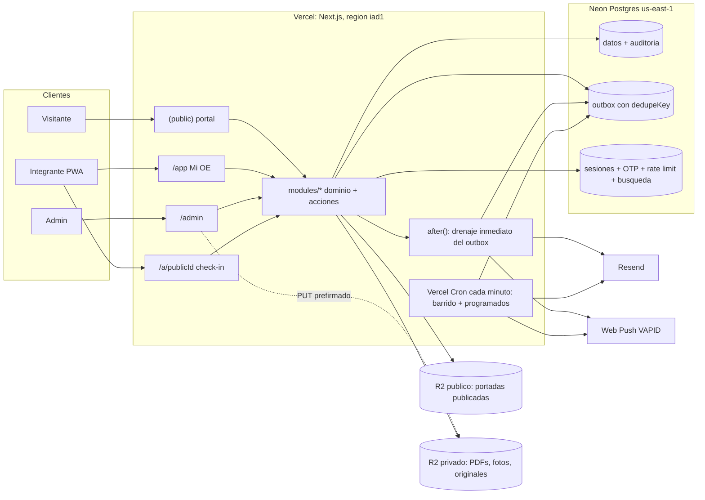

# Arquitectura

Monolito modular en **Next.js (App Router) + TypeScript + Prisma** desplegado como funciones serverless en **Vercel**, con un único **PostgreSQL en Neon** y almacenamiento de archivos en **Cloudflare R2**. No hay procesos permanentes, Redis ni colas de terceros: el trabajo de fondo sale por un outbox transaccional drenado por `after()` y por crons de Vercel.

## Vista general



## Módulos

Cada módulo vive en `src/modules/<módulo>/` con `schema.prisma` (Prisma en modo carpeta `prisma/schema/`), `domain/` (comandos, lecturas y `*-pure.ts` sin I/O), `actions.ts` (server actions), `jobs.ts` (handlers de outbox y programados), `events.ts` y `components/`. Los módulos no se importan entre sí por dentro: se hablan por lecturas explícitas exportadas y por eventos de dominio.

| Módulo | Responsabilidad | Modelos principales |
| --- | --- | --- |
| `identity` | Acceso por OTP, sesiones, permisos técnicos, actor | `Session`, `OtpChallenge`, `Permission` |
| `people` | La persona como eje del CRM, ciclo de vida, comités por término, cargos, consentimiento | `Person`, `Membership`, `CommitteeMembership`, `Appointment`, `Consent`, `Committee` |
| `crm` | Organizaciones, contactos, pipelines, tarjetas, línea de tiempo, notas, tareas, etiquetas, segmentos | `Organization`, `OrganizationContact`, `Pipeline`, `PipelineStage`, `Card`, `Interaction`, `Task`, `Tag`, `Segment` |
| `forms` | Formularios propios (públicos y de integrantes), respuestas, inscripciones a ediciones | `Form`, `Submission`, `EditionRegistration` |
| `events` | Eventos permanentes, ediciones, comités organizadores, calendario ICS | `Event`, `EventEdition`, `EditionCommittee` |
| `participation` | Términos, ocasiones (actividad, asamblea, sesión de edición), check-ins, ledger, rankings, score de comité | `Term`, `Occasion`, `CheckIn`, `PointEntry`, `CommitteeParticipation`, `TermStanding`, `AssemblyRequirement` |
| `content` | Páginas editables, cartelera, medios, documentos de normativa, ficha editorial de comité | `Page`, `Announcement`, `MediaAsset`, `Document` |
| `comms` | Plantillas, campañas, mensajes, suscripciones push, preferencias | `EmailTemplate`, `Campaign`, `Message`, `PushSubscription`, `NotificationPreference` |
| `system` | Auditoría, configuración, outbox, importaciones, exportes, alias legados, salud | `AuditLog`, `AppConfig`, `Outbox`, `ImportJob`, `LegacyAlias` |

## Capas dentro de un request

| Capa | Dónde | Puede | No debe |
| --- | --- | --- | --- |
| Páginas RSC | `src/app/**` | Leer por las lecturas exportadas de cada módulo y renderizar | Consultar Prisma directamente |
| Componentes client | `src/modules/*/components`, `src/shared/ui` | Enviar `FormData` a server actions, transiciones de UI | Autorizar o calcular puntos |
| Proxy | `src/proxy.ts` | Redirigir rutas protegidas sin cookie, emitir CSP con nonce | Decidir roles o estados |
| Server actions | `src/modules/*/actions.ts` | Parsear con Zod, resolver el actor, llamar al dominio, revalidar | Reimplementar reglas |
| Dominio | `src/modules/*/domain` | Invariantes, transacciones, auditoría, outbox | Conocer cookies o Tailwind |
| Jobs | `src/modules/*/jobs.ts`, `src/jobs/` | Handlers idempotentes de outbox y programados | Tocar la base sin transacción o sin lock |
| Compartido | `src/shared/**`, `src/db/**` | Marca, UI base, admin kit, cliente Prisma, helpers puros | Lógica de negocio |

## Piezas transversales

- **Outbox transaccional sin worker permanente.** Cada comando escribe mutación, auditoría y eventos de dominio en la misma transacción (`src/db/tx.ts`). Los efectos salen por dos caminos: (1) `after()` de `next/server` drena el outbox apenas responde el request, así un check-in dispara push y línea de tiempo en segundos; (2) el cron `/api/cron/drain` cada minuto recoge lo que quedó por una función terminada o un error, con reintentos y `deadLetterAt` visible en `/admin/sistema/jobs`. Cada handler es idempotente, corto (menos de 60 s) y procesa por lotes. Los recomputes usan `dedupeKey` (por ocasión) y `pg_advisory_xact_lock`, así N funciones concurrentes colapsan en un solo cálculo. Detalle en [ADR-012](adr/ADR-012-outbox-transaccional.md).
- **Programados** (`vercel.json` → `/api/cron/*`, protegidos por `CRON_SECRET`): `drain` cada minuto, `campaigns` cada minuto (lotes dentro del límite del proveedor), `reminders` cada hora, `prune` diario (sesiones, OTP, outbox procesado), `retention` mensual (anonimización de egresados), `backup-check` diario (verifica que el último `pg_dump` en R2 tenga menos de 36 horas).
- **Eventos de dominio → línea de tiempo.** `checkin.approved`, `points.credited`, `membership.changed`, `stage.changed`, `submission.received`, `message.sent` y `card.moved` producen `Interaction` en la persona. El CRM se alimenta solo.
- **Admin kit declarativo** (`src/shared/admin-kit/`): `defineResource({ modelo, columnas, filtros, formulario Zod, permisos })` genera listado paginado con búsqueda, ficha, crear/editar en panel lateral y export CSV. Cubre Comité, Término, Etiqueta, Organización, Formulario, Plantilla, Página, Documento, Anuncio y Pipeline. UI a medida solo para Persona 360, kanban, consola de ocasión, ledger, campañas e importaciones. Paleta de comandos (⌘K) con búsqueda `pg_trgm` sobre personas, organizaciones y ocasiones.
- **Marca** (`src/shared/brand/`): tokens CSS, texturas ligeras (ruido SVG + mezcla), componente `Cartel` para portadas tipográficas, tema claro/oscuro, movimiento reducido. Ver [07-marca.md](07-marca.md).
- **Adaptadores:** `Mailer` (`console` en desarrollo y previews, `resend` en producción; `ses` como alternativa del mismo contrato), `Storage` (R2 vía S3 SigV4 con URLs prefirmadas; emulador local en desarrollo), `Pusher` (web-push con VAPID).

## Límites de Vercel que moldean el diseño

- **Cuerpo de 4,5 MB por función.** Las subidas van directas del navegador a R2 con `PUT` prefirmado (CORS en el bucket); la función solo registra el `MediaAsset`, valida el objeto con `HEAD`, genera variantes con `sharp` y las escribe en R2. Ningún archivo se transmite a través de la función: los medios publicados se sirven desde el bucket público (`media.oeeafit.com`, egreso gratis) y los privados por redirect a un `GET` prefirmado de 10 minutos tras validar sesión y audiencia.
- **Sin proceso permanente.** Nada depende de un worker vivo: outbox + `after()` + cron. Importaciones y migraciones grandes corren como scripts locales contra `DIRECT_URL`, no en funciones.
- **Una región.** Funciones en `iad1` y Neon en `us-east-1`: de 1 a 3 ms a la base. Runtime Node (Prisma), nunca Edge. Desde Medellín la latencia a `iad1` ronda los 80 ms; suficiente para este uso.
- **Conexiones.** `DATABASE_URL` pooled (PgBouncer, `?pgbouncer=true`) para la app y `DIRECT_URL` para `prisma migrate`; locks solo transaccionales (`pg_advisory_xact_lock`), nunca de sesión.
- **Neon gratis.** 0,5 GB (el dato completo de la OE cabe de sobra) y 100 CU-horas al mes, que equivalen a unas 13 horas despierta al día. Se configura alerta de uso; si se supera, Neon Launch cobra por uso (≈ US$8 a 12 al mes a este ritmo) y suma 7 días de restauración.
- **Previews.** Integración oficial Vercel↔Neon: rama de base por preview, correo en consola, bucket de preview. Cada PR se prueba con datos propios sin tocar producción.
- **Duración.** Las funciones tienen 300 s por defecto (800 s en Pro con configuración); ningún handler debe acercarse: exportes e importaciones grandes se parten en lotes o corren en local.

## Layout del repositorio (cuando exista código)

```
web/                            (hoy la carpeta se llama Untitled)
  vercel.json                   crons y región
  prisma/schema/*.prisma        un archivo por módulo + migrations/ (incluye uniques parciales idempotentes)
  src/app/
    (public)/                   /  /la-oe  /cartelera  /eventos/[slug]/[edicion]  /comites/[slug]  /unirse  /f/[slug]  /privacidad
    app/                        inicio, eventos, comites, personas, gh-points, normativa, carnet, ajustes
    admin/                      personas, organizaciones, pipelines, formularios, comunidad, contenido, participacion, comunicaciones, sistema
    a/[publicId]/               check-in (sin sesión → /ingresar y vuelve)
    ingresar/                   OTP
    api/                        health, media/[id], ics, push, export, cron/*
  src/modules/<módulo>/         schema, domain, actions, jobs, events, components
  src/shared/                   brand, ui (shadcn base), admin-kit, lib
  src/db/                       cliente Prisma (pooled), tx + outbox, errores unique
  src/jobs/                     registro de handlers de outbox y programados
  public/logos/                 oe.svg + 27 comités (hoy en ../public/logos)
  scripts/                      import-roster.ts, migrate-ghpoints.ts, verify-migration.ts, backup.ts
  tests/                        unit, integration (Postgres), e2e (Playwright)
```

## Infraestructura y costo

| Concepto | Costo |
| --- | --- |
| Vercel Pro, 1 asiento (crons por minuto, 800 s por función, previews protegidas) | US$20/mes |
| Neon Free (0,5 GB, 100 CU-horas, restauración 6 h, 10 ramas) | US$0; si el tope molesta, Launch por uso ≈ US$8 a 12 |
| Cloudflare R2 (10 GB, egreso gratis, 1 M escrituras y 10 M lecturas al mes) | US$0 |
| Resend gratis (3.000 correos/mes, 100/día) | US$0; SES (US$0,10 por 1.000) si un día de evento supera 100 OTP |
| GitHub Actions: `pg_dump` nocturno cifrado a R2 (`backup.ts`) | US$0 |
| Web push, dominio existente, fuentes sustitutas | US$0 |
| **Total esperado** | **US$20/mes** (hasta ≈ US$30 si Neon pasa a Launch) |
| Durante la convivencia | + Railway de GHPOINTS hasta el cutover; después se cancela |

Vercel Hobby (US$0) queda como plan B con dos costos: los crons solo corren una vez al día (el drenaje dependería solo de `after()`) y su licencia es para uso personal no comercial, zona gris para el sitio oficial de una organización.

## Alternativas evaluadas (2026-09-02)

| Opción | Costo real | Jobs de fondo | Postgres + bucket | Operación | Veredicto |
| --- | --- | --- | --- | --- | --- |
| Railway, workspace Pro actual de GHPOINTS | US$0 extra durante la convivencia; US$20 después | Worker en el mismo proceso | Incluidos, mismo panel, PITR ya configurado | Mínima | Recomendada por simplicidad; descartada por preferencia de DX y CDN de Vercel |
| Railway Hobby | ≈ US$5 a 7 | Igual | Incluidos, respaldos diarios | Mínima | Válida; misma razón |
| **Vercel + Neon + R2** | US$20 (Pro) o US$0 (Hobby con límites) | Sin proceso permanente: outbox + cron por minuto | Tres proveedores; Neon gratis se suspende al estar inactivo | Baja, más piezas | **Elegida** |
| Render | ≈ US$13 (web + Postgres) | Worker aparte cuesta otro servicio | Sin bucket propio | Baja | Descartada |
| Hetzner + Coolify | ≈ US$5 | Todo en una máquina | Vos instalás Postgres y MinIO | Alta: sos el sysadmin | Descartada |
| Fly.io (región Bogotá) | Variable | Máquinas permanentes | Postgres poco gestionado | Media-alta | Descartada: latencia mejor, más operación |

## Seguridad transversal

- Cabeceras: `X-Content-Type-Options`, `X-Frame-Options`, `Referrer-Policy`, `Permissions-Policy`, `Strict-Transport-Security`; CSP en modo enforce con nonce por request desde el proxy.
- Redirecciones validadas (solo rutas same-origin), celdas de CSV/XLSX neutralizadas contra fórmulas, HTML de correos escapado.
- Secretos solo en variables de servidor; nunca `NEXT_PUBLIC_*` para claves.
- Auditoría en la misma transacción de cada mutación administrativa; exportes con datos personales exigen step-up (ver [05-acceso.md](05-acceso.md)).
