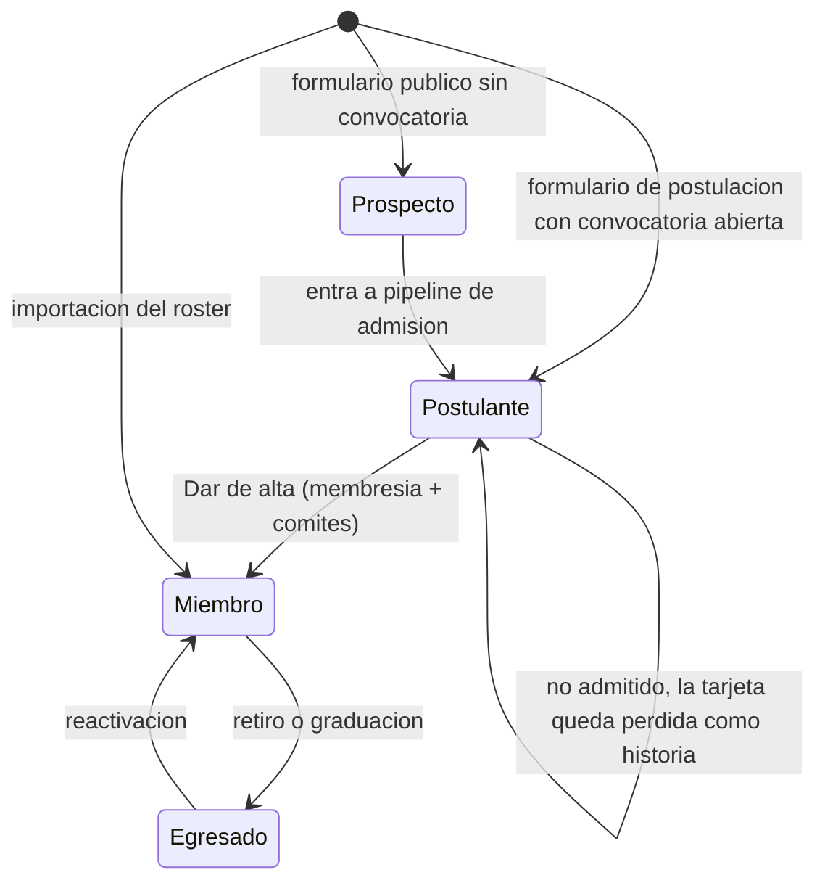

# CRM de comunidad

La casa digital se piensa como un **CRM de comunidad**: la columna vertebral del admin es la persona y su relación con la OE a lo largo del tiempo. No es un clon de Salesforce ni un CRM comercial genérico: lo que se modela es el ciclo de vida de quien pasa por la organización y de quienes la rodean.

## Qué aporta

- **La persona es el eje.** Miembro, postulante, egresado, contacto de empresa o de Bienestar son la misma entidad `Person`, con `kind` (`STUDENT` o `EXTERNAL`) y una etapa. Nada personal se guarda dos veces. El roster entra por un archivo por término con un formato fijo ([13-importacion-del-roster.md](13-importacion-del-roster.md)).
- **Ciclo de vida explícito:** `PROSPECTO` (llenó un formulario) → `POSTULANTE` (en pipeline de admisión) → `MIEMBRO` (activo, en licencia u honorario) → `EGRESADO` (retirado o graduado). Cada cambio es un comando que audita y escribe la línea de tiempo ([ADR-003](adr/ADR-003-etapas-por-comando.md)).
- **La línea de tiempo se alimenta sola.** Asistencias, puntos, cambios de comité, cargos, formularios, correos y movimientos de pipeline producen interacciones automáticas; el equipo agrega notas y tareas encima.
- **Todo lo que hoy es un Excel o un Forms** (roster, postulaciones, inscripciones, patrocinios, contactos de Bienestar) vive en el mismo lugar y se relaciona.

## Personas y etapas

| Etapa | Cómo se entra | Qué puede hacer | Qué guarda |
| --- | --- | --- | --- |
| Prospecto | Formulario público (`source = FORM`), alta manual | Nada en la app | Datos del formulario, consentimiento de tratamiento de datos |
| Postulante | Tarjeta en un pipeline `ADMISSION` (desde una respuesta o creada a mano) | Nada en la app | Respuestas, entrevistas, notas del equipo; si no es admitido, la tarjeta queda perdida y la persona sigue postulante con su historia ([ADR-037](adr/ADR-037-admision-aliados-y-contactos-fase-5.md)) |
| Miembro | "Dar de alta" o importación | Mi OE, check-in, GH Points | Membresía, comités por término, cargos, participación |
| Egresado | Baja o graduación | Nada en la app: el correo institucional caduca al graduarse. Su perfil queda como **egresado** (memorial): historia institucional visible para miembros en la galería por año si dio consentimiento | Nombre, foto con consentimiento, comités y cargos por término, años en la OE, puntos y reconocimientos; correo personal solo con consentimiento de contacto; sin celular, formularios ni tareas |

Los contactos externos (`kind=EXTERNAL`) no tienen etapa de miembro ni acceso: son personas vinculadas a organizaciones.

## Persona 360

`/admin/personas/[id]` es la pantalla más importante del admin. Cabecera con nombre, etapa, estado de membresía, comités del término, cargos y etiquetas; acciones de etapa según el estado (editar datos, cambiar estado, dar de baja, reactivar, anonimizar, nota, tarea, etiquetas, permisos), cada una en un panel lateral. Es UI a medida desde la fase 2 ([ADR-034](adr/ADR-034-personas-y-mi-oe-fase-2.md)); las pestañas de fases posteriores existen desde el principio y muestran "llega en una fase siguiente" hasta que su fase las llene. Pestañas:

| Pestaña | Contenido |
| --- | --- |
| Resumen | Puntos del término, asistencias, asambleas firmadas/requeridas, último contacto, tareas abiertas |
| Línea de tiempo | Interacciones automáticas y notas, con filtro por tipo y compositor de nota |
| Membresía | Términos, comités por término con el cargo en cada uno (General, Financiero, Logística…), cargos de junta o de GH, transferencias, historial de estados con motivos |
| Participación | Check-ins con ocasión y fuente; ledger con ajustes y reversiones |
| Permanencia | Resultado por cada comité frente a su umbral, parte general y parte del comité criterio por criterio, condición (nuevo, prueba, transferencia), grupos y evaluaciones, puntajes y observaciones del líder, decisiones de cierre |
| Formularios | Respuestas enviadas, inscripciones a ediciones y tarjetas de pipeline, con enlace al kanban |
| Comunicaciones | Mensajes enviados (correo y push), preferencias, suscripciones push |
| Tareas | Pendientes y cerradas sobre la persona |
| Solicitudes | Licencias, retiros y cambios de comité pedidos por la persona, con la decisión de GH y la posibilidad de decidir desde la misma pestaña |
| Datos y consentimiento | Campos personales, consentimientos por propósito, exportar datos, solicitar eliminación |

## Pipelines

Un `Pipeline` tiene etapas ordenadas con marcas `isWon` / `isLost`; una `Card` es una persona o una organización avanzando por él. Mover una tarjeta es un comando que registra una interacción en el sujeto.

| Tipo | Sujeto | Plantilla de etapas | Al ganar |
| --- | --- | --- | --- |
| `ADMISSION` | Persona | Recibida → Entrevista → Admitida → Alta (ganada) · No admitida (perdida) | "Dar de alta" (`people.admitPerson`): crea `Membership` con término actual, 1 a 3 comités, `firstTermId` y consentimiento de membresía, y mueve la tarjeta a Alta; todo en una transacción; el correo de bienvenida (T-200) sale por outbox. Mover a mano a Alta solo se permite si la persona ya tiene membresía |
| `SPONSORSHIP` | Organización, con edición | Contacto → Propuesta → Negociación → Cerrado (ganada) · Sin acuerdo (perdida) | Registra monto, contraprestación (`fields.counterpart`) y responsable; al ganar crea una tarea de seguimiento al responsable |
| `CUSTOM` | Persona u organización | Una etapa inicial; el admin agrega las demás | Sin efecto automático |

Una convocatoria de admisión es un formulario público con la acción "entrar al pipeline X"; cerrarla es cerrar el formulario. Las respuestas aparecen como tarjetas con sus datos (las crea el outbox al recibir la respuesta) y la persona pasa a postulante. Las etapas de cada pipeline se renombran, reordenan y marcan como ganada o perdida desde el kanban; mover una tarjeta se hace con el selector "Mover a…" o arrastrando ([ADR-037](adr/ADR-037-admision-aliados-y-contactos-fase-5.md)).

## Organizaciones y contactos

`Organization` (`COMPANY`, `EAFIT_UNIT`, `STUDENT_GROUP`, `OTHER`: empresa, unidad de EAFIT, grupo estudiantil u otra) con sitio web, notas y contactos: personas externas (`kind = EXTERNAL`, creadas desde la ficha o vinculadas) con rol e indicador de contacto principal. Bienestar, Desarrollo Estudiantil, docentes y otros grupos viven aquí, con su línea de tiempo (notas y movimientos de sus tarjetas), sus tareas, sus etiquetas y sus tarjetas de patrocinio por edición ([ADR-037](adr/ADR-037-admision-aliados-y-contactos-fase-5.md)).

## Segmentos y listas

Un `Segment` es un filtro guardado: etapa, estado, término, comité, etiqueta, rango de puntos, sin check-in desde una fecha, sin asamblea firmada, con o sin consentimiento de comunicaciones. Alimenta campañas, exportes CSV y listas operativas del día ("activos sin asamblea firmada en 2026-2").

## Tareas

`Task` con título, tipo (general, solicitud de eliminación, solicitud de miembro), responsable, vencimiento, sujeto (persona, organización o tarjeta) y estado. El inicio del admin (`/admin`) es un tablero: pendientes del actor, tareas vencidas del equipo, solicitudes pendientes, respuestas recientes por formulario, tarjetas por etapa de cada pipeline, convocatorias y ocasiones abiertas, y alertas de sistema ([ADR-037](adr/ADR-037-admision-aliados-y-contactos-fase-5.md)).

## Solicitudes y convocatorias

Un miembro activo pide desde Mi OE una licencia, su retiro voluntario o un cambio de comité; el cambio se pide siempre para el semestre siguiente y es una transferencia interna (umbral 70 % en el comité nuevo). La solicitud abre una tarea para GH y no cambia nada hasta que GH aprueba: aprobar ejecuta el mismo comando de `people` que haría a mano, en la misma transacción; rechazar exige motivo; la respuesta llega por correo porque quien queda en licencia o se retira pierde el acceso. Una convocatoria interna llama a inscribirse en un grupo de trabajo con cupo, ventana y selección por orden de llegada (con lista de espera) o manual del líder; la inscripción aceptada entra al grupo por outbox ([ADR-031](adr/ADR-031-autogestion-del-miembro.md), [ADR-037](adr/ADR-037-admision-aliados-y-contactos-fase-5.md)).

## Reglas del CRM

1. Una persona se identifica por su correo en minúsculas; los formularios vinculan por ese correo antes de crear.
2. Ningún formulario ni login crea miembros: solo la importación o "Dar de alta".
3. Las interacciones automáticas son inmutables; las notas pueden editarse por su autor y quedan con `editedAt`.
4. Las etiquetas y segmentos no cambian el estado de nadie: describen, no deciden.
5. El correo y el teléfono se ven solo con permiso `ADMIN`; los líderes ven nombre, comités y cargos.
6. Las solicitudes del miembro no cambian nada hasta que GH las aprueba; aprobar ejecuta el mismo comando que haría un admin a mano ([ADR-031](adr/ADR-031-autogestion-del-miembro.md)).
7. La persona mantiene sus propios datos (foto, celular, correo personal) desde Ajustes, con consentimiento por propósito; el correo institucional no se edita.

## Privacidad por diseño (Ley 1581 de 2012)

Un CRM es un archivo de datos personales; esto no es opcional.

- `Consent` versionado por propósito (`MEMBERSHIP`, `COMMUNICATIONS`, `DIRECTORY_PHOTO`, `MEMORIAL`, `DATA_PROCESSING` para quien responde un formulario público) y por fuente (`FORM`, `IMPORT`, `ADMIN`, `SELF`), con fecha, versión de la política e IP cuando aplica.
- Público: cero datos personales. Directorio interno: nombre, foto opcional con consentimiento, comités y cargos.
- "Descargar mis datos" (JSON con todo, notas incluidas) y "Solicitar eliminación" desde Ajustes; la solicitud estampa `deletionRequestedAt`, crea una tarea de tipo `DELETION_REQUEST` sin responsable (la ven todos los ADMIN) con vencimiento a 15 días hábiles (`privacy.deletionDays`) y se atiende con "Anonimizar" desde la Persona 360, con step-up.
- Salida: no hay anonimización por plazo. Al salir, el perfil pasa a egresado y se depura lo que no es historia (celular salvo consentimiento de contacto, respuestas de formularios, tareas); notas y evaluaciones quedan solo para ADMIN; nombre, comités, cargos, años y ledger se conservan como historia institucional, visibles en la galería de egresados si hay consentimiento `MEMORIAL`. La eliminación a pedido anonimiza de inmediato ([ADR-030](adr/ADR-030-perfil-de-egresado.md)).
- La política de tratamiento se publica en `/privacidad`; su versión vigente es la que registran los consentimientos nuevos. Detalle en [ADR-014](adr/ADR-014-privacidad-por-diseno.md).
