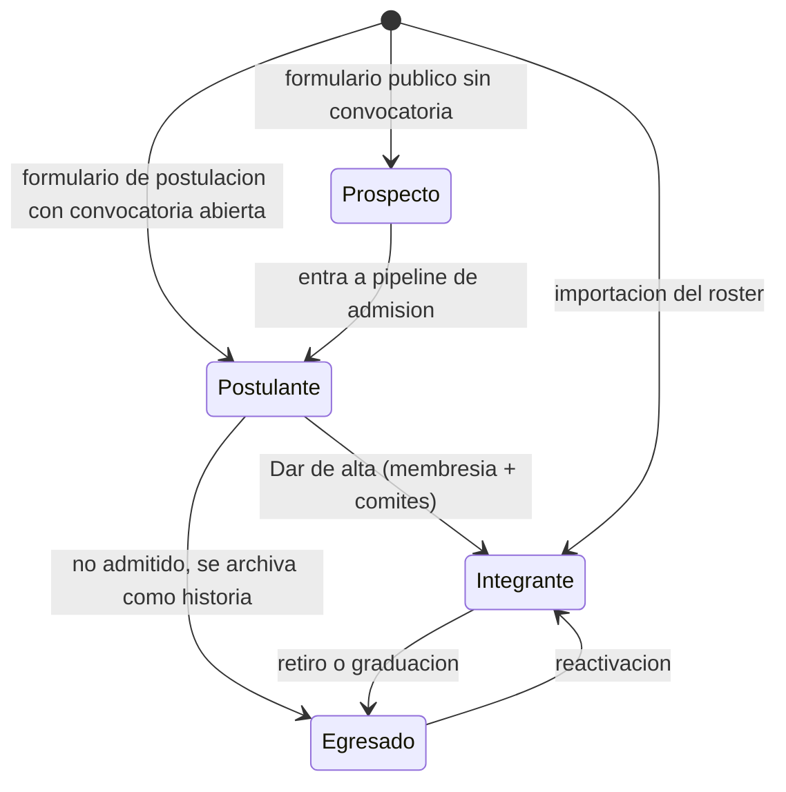

# CRM de comunidad

La casa digital se piensa como un **CRM de comunidad**: la columna vertebral del admin es la persona y su relación con la OE a lo largo del tiempo. No es un clon de Salesforce ni un CRM comercial genérico: lo que se modela es el ciclo de vida de quien pasa por la organización y de quienes la rodean.

## Qué aporta

- **La persona es el eje.** Integrante, postulante, egresado, contacto de empresa o de Bienestar son la misma entidad `Person`, con `kind` (`STUDENT` o `EXTERNAL`) y una etapa. Nada personal se guarda dos veces.
- **Ciclo de vida explícito:** `PROSPECTO` (llenó un formulario) → `POSTULANTE` (en pipeline de admisión) → `INTEGRANTE` (vigente, en licencia u honorario) → `EGRESADO` (retirado o graduado). Cada cambio es un comando que audita y escribe la línea de tiempo ([ADR-003](adr/ADR-003-etapas-por-comando.md)).
- **La línea de tiempo se alimenta sola.** Asistencias, puntos, cambios de comité, cargos, formularios, correos y movimientos de pipeline producen interacciones automáticas; el equipo agrega notas y tareas encima.
- **Todo lo que hoy es un Excel o un Forms** (roster, postulaciones, inscripciones, patrocinios, contactos de Bienestar) vive en el mismo lugar y se relaciona.

## Personas y etapas

| Etapa | Cómo se entra | Qué puede hacer | Qué guarda |
| --- | --- | --- | --- |
| Prospecto | Formulario público, alta manual | Nada en la app | Datos del formulario, consentimiento |
| Postulante | Convocatoria abierta, tarjeta en pipeline `ADMISSION` | Nada en la app | Respuestas, entrevistas, notas del equipo |
| Integrante | "Dar de alta" o importación | Mi OE, check-in, GH Points | Membresía, comités por término, cargos, participación |
| Egresado | Baja o graduación | Nada en la app: el correo institucional suele caducar al graduarse, así que un acceso futuro sería con correo personal verificado (fuera de v1) | Historia completa; correo personal opcional y consentimiento de contacto capturados al salir |

Los contactos externos (`kind=EXTERNAL`) no tienen etapa de integrante ni acceso: son personas vinculadas a organizaciones.

## Persona 360

`/admin/personas/[id]` es la pantalla más importante del admin. Cabecera con nombre, etapa, estado de membresía, comités del término, cargos y etiquetas; acciones de etapa según el estado. Pestañas:

| Pestaña | Contenido |
| --- | --- |
| Resumen | Puntos del término, asistencias, asambleas firmadas/requeridas, último contacto, tareas abiertas |
| Línea de tiempo | Interacciones automáticas y notas, con filtro por tipo y compositor de nota |
| Membresía | Términos, comités por término, cargos, historial de estados con motivos |
| Participación | Check-ins con ocasión y fuente; ledger con ajustes y reversiones |
| Permanencia | Porcentaje del término frente al umbral, parte OE y parte del comité criterio por criterio, grupos y evaluaciones, puntajes y observaciones del líder, decisión de cierre |
| Formularios | Respuestas enviadas, con enlace a la tarjeta de pipeline si existe |
| Comunicaciones | Mensajes enviados (correo y push), preferencias, suscripciones push |
| Tareas | Pendientes y cerradas sobre la persona |
| Datos y consentimiento | Campos personales, consentimientos por propósito, exportar datos, solicitar eliminación |

## Pipelines

Un `Pipeline` tiene etapas ordenadas con marcas `isWon` / `isLost`; una `Card` es una persona o una organización avanzando por él. Mover una tarjeta es un comando que registra una interacción en el sujeto.

| Tipo | Sujeto | Plantilla de etapas | Al ganar |
| --- | --- | --- | --- |
| `ADMISSION` | Persona | Recibida → Entrevista → Admitida → Alta | "Dar de alta": crea `Membership` con término actual, 1 a 3 comités, `firstTermId`, envía correo de bienvenida. Todo en una transacción |
| `SPONSORSHIP` | Organización, con edición | Contacto → Propuesta → Negociación → Cerrado | Registra monto, contraprestación y responsable; crea tareas de seguimiento |
| `CUSTOM` | Persona u organización | Definidas por el admin | Sin efecto automático |

Una convocatoria es un formulario de postulación con la acción "entrar al pipeline X"; cerrarla es cerrar el formulario. Las respuestas aparecen como tarjetas con sus datos.

## Organizaciones y contactos

`Organization` (`EMPRESA`, `UNIDAD_EAFIT`, `GRUPO_ESTUDIANTIL`, `OTRA`) con sitio web, notas y contactos: personas externas con rol e indicador de contacto principal. Bienestar, Desarrollo Estudiantil, docentes y otros grupos viven aquí, con su línea de tiempo (notas, reuniones, correos) y sus tarjetas de patrocinio por edición.

## Segmentos y listas

Un `Segment` es un filtro guardado: etapa, estado, término, comité, etiqueta, rango de puntos, sin check-in desde una fecha, sin asamblea firmada, con o sin consentimiento de comunicaciones. Alimenta campañas, exportes CSV y listas operativas del día ("vigentes sin asamblea firmada en 2026-2").

## Tareas

`Task` con título, responsable, vencimiento, sujeto (persona, organización o tarjeta) y estado. El inicio del admin muestra "Pendientes" del actor y las vencidas del equipo.

## Reglas del CRM

1. Una persona se identifica por su correo en minúsculas; los formularios vinculan por ese correo antes de crear.
2. Ningún formulario ni login crea integrantes: solo la importación o "Dar de alta".
3. Las interacciones automáticas son inmutables; las notas pueden editarse por su autor y quedan con `editedAt`.
4. Las etiquetas y segmentos no cambian el estado de nadie: describen, no deciden.
5. El correo y el teléfono se ven solo con permiso `ADMIN`; los líderes ven nombre, comités y cargos.

## Privacidad por diseño (Ley 1581 de 2012)

Un CRM es un archivo de datos personales; esto no es opcional.

- `Consent` versionado por propósito (`MEMBERSHIP`, `COMMUNICATIONS`, `DIRECTORY_PHOTO`) y por fuente (`FORM`, `IMPORT`, `ADMIN`), con fecha, versión de la política e IP cuando aplica.
- Público: cero datos personales. Directorio interno: nombre, foto opcional con consentimiento, comités y cargos.
- "Descargar mis datos" (JSON) y "Solicitar eliminación" desde Ajustes; la solicitud crea una tarea para un ADMIN con plazo de 15 días hábiles.
- Retención: egresados sin consentimiento vigente se anonimizan a los 5 años (teléfono, notas, respuestas de formularios); nombre, comités, cargos y ledger se conservan como historia institucional.
- La política de tratamiento se publica en `/privacidad`; su versión vigente es la que registran los consentimientos nuevos. Detalle en [ADR-014](adr/ADR-014-privacidad-por-diseno.md).
