# Modelo de datos

PostgreSQL en Railway, Drizzle con el esquema de cada módulo en `src/modules/<módulo>/schema.ts` ([ADR-032](adr/ADR-032-drizzle-y-esquema-por-modulo.md)). En SQL las tablas y columnas van en `snake_case` (`point_entry.check_in_id`) y en el código en `camelCase`; esta página usa los nombres del código. Convenciones: ids `cuid2`; identificadores públicos `nanoid` solo donde se exponen en URL o QR; timestamps `timestamptz` en UTC; fechas de término como `date`; JSON parseado con Zod en la frontera de lectura; sin borrado físico de personas (anonimización).

La correspondencia de este modelo con los Estatutos y el Reglamento Interno 2026, con lo que coincide, lo que decide distinto y lo que no modela, está en [18-revision-normativa-2026.md](18-revision-normativa-2026.md).

## Diagrama

```mermaid
erDiagram
  Person ||--o| Membership : "ciclo de vida"
  Person ||--o{ CommitteeMembership : "por termino"
  Committee ||--o{ CommitteeMembership : ""
  Term ||--o{ CommitteeMembership : ""
  CommitteeMembership ||--o{ CommitteeRoleAssignment : "cargos"
  Person ||--o{ Appointment : "cargos"
  Person ||--o{ Permission : "permisos"
  Person ||--o{ Interaction : "linea de tiempo"
  Person ||--o{ Consent : ""
  Person ||--o{ Task : ""
  Person ||--o{ OnboardingProgress : ""
  Document ||--o{ DocumentArticle : ""
  Organization ||--o{ OrganizationContact : ""
  Person ||--o{ OrganizationContact : ""
  Pipeline ||--o{ PipelineStage : ""
  Pipeline ||--o{ Card : ""
  Person ||--o{ Card : "postulacion"
  Organization ||--o{ Card : "patrocinio"
  Form ||--o{ Submission : ""
  Person ||--o{ Submission : ""
  EventEdition ||--o{ EditionRegistration : ""
  Person ||--o{ Request : "solicitudes"
  WorkGroup ||--o{ InternalCall : "convocatorias"
  InternalCall ||--o{ InternalCallEntry : ""
  Person ||--o{ InternalCallEntry : ""
  Organization ||--o{ Interaction : "notas"
  Event ||--o{ EventEdition : ""
  EventEdition ||--o{ Occasion : "sesiones"
  Term ||--o{ Occasion : ""
  Occasion ||--o{ CheckIn : ""
  Person ||--o{ CheckIn : ""
  CheckIn ||--o| PointEntry : "credito"
  Term ||--o{ PointEntry : "ledger"
  Occasion ||--o{ CommitteeParticipation : "score"
  Term ||--o| TermStanding : "cierre"
  Term ||--o{ AssemblyRequirement : "ajustes"
  Person ||--o{ AssemblyRequirement : ""
  Campaign ||--o{ Message : ""
  Campaign ||--o{ CampaignRecipient : ""
  EmailTemplate ||--o{ Campaign : ""
  Segment ||--o{ Campaign : ""
  Person ||--o{ Message : ""
  Person ||--o{ PushSubscription : ""
  Person ||--o| NotificationPreference : ""
  Person ||--o| CalendarToken : ""
  Person ||--o| CarnetToken : "billeteras"
  Person ||--o{ WalletPass : "pases"
  Occasion ||--o{ OccasionSurveyInvite : ""
  Occasion ||--o{ OccasionSurveyResponse : "anonimas"
  Person ||--o{ Session : ""
  Term ||--o{ PermanenceRule : "criterios"
  Term ||--o{ WorkGroup : ""
  WorkGroup ||--o{ WorkGroupMembership : ""
  Person ||--o{ WorkGroupMembership : "evaluacion"
  Person ||--o{ PermanenceSnapshot : "permanencia"
  Person ||--o{ PermanenceDecision : "cierre"
  Person ||--o{ LeaderScore : ""
  Person ||--o{ Recognition : ""
```

## Modelos por módulo

### identity

| Modelo | Campos clave | Notas |
| --- | --- | --- |
| `Session` | `personId`, `tokenHash` único, `expiresAt`, `userAgent`, `ip`, `lastSeenAt` | 90 días, renovable; se destruye al cambiar estado o correo |
| `OtpChallenge` | `email`, `codeHash`, `expiresAt`, `attempts`, `maxAttempts`, `consumedAt`, `ip` | 10 minutos, 5 intentos; rate limit contando filas |
| `Permission` | `personId`, `code` (`ADMIN`, `COMMITTEE_LEADER`, `BOARD`), `committeeId?`, `grantedById` | Unique parcial por (persona, código, comité); `BOARD` se otorga con los cargos de junta y da acceso al panel de la junta |
| `CalendarToken` | `personId` único, `token` único (24 bytes aleatorios en base64url, en claro), `createdAt`, `lastUsedAt?` | Capacidad de solo lectura sobre la agenda propia para `GET /api/ics/mi-agenda.ics?t=…`; regenerarlo invalida el anterior ([ADR-038](adr/ADR-038-comunicaciones-y-pwa-fase-6.md)) |
| `CarnetToken` | `personId` único (cascade), `token` único (`oe2.` + 24 bytes aleatorios base64url, en claro), `walletEpoch`, `revision` desde 1, `createdAt`, `lastUsedAt?` | QR persistente de billetera. La generación debe coincidir con `Membership.walletEpoch`; rotar cambia token/revisión y audita sin guardar el secreto en el evento. Lectura asíncrona por `readCarnet` ([ADR-040](adr/ADR-040-carnet-en-billeteras-fase-8.md)) |

### people

| Modelo | Campos clave | Notas |
| --- | --- | --- |
| `Person` | `email` único en minúsculas, `kind` (`STUDENT`, `EXTERNAL`), `stage`, `firstName`, `lastName`, `fullName` (compuesto), `preferredName?`, `phone?`, `personalEmail?`, `program?`, `photoAssetId?`, `source` (`ADMIN`, `ROSTER`, `FORM`, `GHPOINTS`, `BOOTSTRAP`), `sessionsRevokedAt?`, `deletionRequestedAt?`, `anonymizedAt?`, `legacyId?` | Búsqueda con `pg_trgm` sobre nombre y correo; `personalEmail` es contacto (egresados y externos), nunca identidad de acceso; `photoAssetId` apunta a un `MediaAsset` y lo valida el dominio (sin clave foránea: la habría entre `people` y `content` en ciclo); `sessionsRevokedAt` invalida las sesiones anteriores al cambiar estado o correo ([ADR-034](adr/ADR-034-personas-y-mi-oe-fase-2.md)); `deletionRequestedAt` y `anonymizedAt` registran la eliminación a pedido; `legacyId` es el id de `Member` en GHPOINTS |
| `Membership` | `personId` único, `status` (`ACTIVE`, `ON_LEAVE`, `HONORARY`, `INACTIVE`), `firstTermId`, `lastTermId?`, `endedAt?`, `walletEpoch` (0 por defecto), `endReason?` (`GRADUATION`, `RESIGNATION`, `PERMANENCE`, `OTHER`) | Una por persona; baja/anonimización incrementan `walletEpoch` en la misma transacción y reactivar no lo reduce (ADR-040); al terminar, el perfil pasa a egresado y se depura lo que no es historia ([ADR-030](adr/ADR-030-perfil-de-egresado.md)) |
| `MembershipEvent` | `membershipId`, `from`, `to`, `reason`, `actorId`, `at` | Historial de estados |
| `Committee` | `slug` único, `name`, `status`, `color`, `logoKey`, `presentation`, `contactUrl`, `publicationStatus`, `legacyId?` | Los 27 logos viven en `public/logos/committees`; `legacyId` es el id en GHPOINTS |
| `CommitteeMembership` | `personId`, `committeeId`, `termId`, `roleCode` (cargo principal derivado de `CommitteeRoleAssignment`; `MIEMBRO` si no hay), `transferredIn`, `joinedAt?`, `leftAt?` | Unique por (persona, comité, término); 1 a 3 activas para activos; `transferredIn` marca una transferencia interna (umbral 70 % en ese comité); los cargos viven en `CommitteeRoleAssignment` y `roleCode` se recalcula en cada escritura hasta retirarlo ([ADR-058](adr/ADR-058-direccion-del-comite-por-areas.md)) |
| `CommitteeRoleAssignment` | `membershipId`, `personId`, `committeeId`, `termId`, `roleCode`, `coDirector`, `startedAt`, `endedAt?` | Un cargo de la pertenencia, titular o codirección; `personId`, `committeeId` y `termId` se copian de la pertenencia para los índices; cerrar la pertenencia cierra sus cargos ([ADR-058](adr/ADR-058-direccion-del-comite-por-areas.md)) |
| `CommitteeRole` | `code` único, `label`, `isLeadership`, `required`, `capabilities[]`, `order` | Catálogo: `GENERAL`, `FINANCIERO`, `PUBLICIDAD`, `MERCADEO`, `RELACIONES_PUBLICAS`, `LOGISTICA` y `GESTION_HUMANA` son dirección (`isLeadership`), `GENERAL` y `FINANCIERO` obligatorios (`required`), cada uno con sus capacidades (`ROSTER`, `DIRECTION`, `PERMANENCE`, `OCCASIONS`, `EVENTS`, `BOARD`, `PROFILE`, `PARTNERS`, `FINANCE`); `MIEMBRO` sin ninguna; editable por GH desde `/admin/cargos` ([ADR-058](adr/ADR-058-direccion-del-comite-por-areas.md)) |
| `MembershipTerm` | `personId`, `termId`, `probation`, `reason?`, `decidedById?` | Condición de la persona en el término: periodo de prueba (umbral 80 %) decidido en el cierre anterior, cargado por el roster o fijado por ADMIN desde la Persona 360 con motivo ([ADR-056](adr/ADR-056-alta-y-condicion-del-semestre-desde-la-persona-360.md)) |
| `Appointment` | `personId`, `kind` (`PRESIDENT`, `VP_GH`, `VP_PUBLIC_RELATIONS`, `VP_ADMIN`, `VP_FINANCE`, `VP_COMMUNICATIONS`, `GH_HEAD`, `GH_DIRECTOR`, `OTHER`), `committeeId?`, `termId`, `title?` | Cargo de junta o de GH, visible y con historia; el líder de comité no es un `Appointment` sino `CommitteeMembership.roleCode = GENERAL` ([ADR-034](adr/ADR-034-personas-y-mi-oe-fase-2.md)); los cargos de junta lideran los comités de trabajo y los de GH evalúan grupos |
| `Consent` | `personId`, `purpose` (`MEMBERSHIP`, `COMMUNICATIONS`, `DIRECTORY_PHOTO`, `MEMORIAL`, `DATA_PROCESSING`), `policyVersion`, `acceptedAt`, `source` (`FORM`, `IMPORT`, `ADMIN`, `SELF`), `ip?`, `revokedAt?` | Una fila por aceptación; revocar estampa `revokedAt`; un solo consentimiento vivo por persona y propósito; `MEMORIAL` habilita la galería de egresados; `DATA_PROCESSING` es la casilla T-154 de un formulario público, con fuente `FORM` e IP ([ADR-037](adr/ADR-037-admision-aliados-y-contactos-fase-5.md)) |

### crm

Importa `people`, `terms`, `content`, `system` y, desde la fase 5, `forms` ([ADR-037](adr/ADR-037-admision-aliados-y-contactos-fase-5.md)); `permanence` no lo importa ni él a `permanence`: las convocatorias entran al grupo por outbox.

| Modelo | Campos clave | Notas |
| --- | --- | --- |
| `Organization` | `name`, `kind` (`COMPANY`, `EAFIT_UNIT`, `STUDENT_GROUP`, `OTHER`), `website?`, `notes?` Markdown, `createdById?` | Nombre único sin distinguir mayúsculas; búsqueda con `pg_trgm`; línea de tiempo por `Interaction.organizationId` ([ADR-037](adr/ADR-037-admision-aliados-y-contactos-fase-5.md)) |
| `OrganizationContact` | `organizationId`, `personId`, `role?`, `isPrimary` | Unique por (organización, persona); un principal por organización; la persona es `kind = EXTERNAL` y nunca inicia sesión |
| `Pipeline` | `name`, `kind` (`ADMISSION`, `SPONSORSHIP`, `CUSTOM`), `isArchived`, `createdById?` | Crearlo siembra la plantilla de etapas de su tipo |
| `PipelineStage` | `pipelineId`, `name`, `sortOrder`, `isWon`, `isLost` | Nunca ganada y perdida a la vez; se renombran y reordenan desde el kanban |
| `Card` | `pipelineId`, `stageId`, `personId?`, `organizationId?`, `editionId?`, `submissionId?`, `ownerId?`, `title`, `fields` JSON, `amount?`, `dueAt?`, `enteredStageAt`, `closedAt?`, `createdById?` | Exactamente uno de `personId` u `organizationId`; una tarjeta por respuesta (`submissionId` único parcial); `closedAt` se estampa al llegar a una etapa ganada o perdida y se limpia al volver; en admisión la persona pasa a `APPLICANT` al entrar y a `MEMBER` con "dar de alta", que mueve la tarjeta a la etapa ganada en la misma transacción |
| `Interaction` | `personId?`, `organizationId?`, `kind`, `occurredAt`, `actorId?`, `refType?`, `refId?`, `summary`, `body?`, `metadata` JSON, `editedAt?` | Al menos un sujeto; automáticas inmutables, escritas por el handler `crm.timeline` a partir de los eventos del outbox con `refType = 'outbox'` y `refId` único (idempotencia); notas (`kind = NOTE`) editables por su autor |
| `Task` | `title`, `kind` (`GENERAL`, `DELETION_REQUEST`, `REQUEST`), `assigneeId?`, `dueAt?`, `status` (`OPEN`, `DONE`), `personId?`, `organizationId?`, `cardId?`, `createdById`, `completedAt?`, `completedById?` | Una tarea sin responsable la ven todos los ADMIN; la solicitud de eliminación vence a `privacy.deletionDays` días hábiles y la solicitud de miembro a `requests.taskDays` |
| `Tag` / `PersonTag` / `OrganizationTag` | `name` único (sin distinguir mayúsculas) | Las tablas `tag`, `person_tag` y `segment` viven en el esquema de `people`, porque el listado y los exportes de personas las necesitan y `people` no depende de `crm` ([ADR-034](adr/ADR-034-personas-y-mi-oe-fase-2.md)); `organization_tag` vive en `crm` y apunta a `tag` |
| `Segment` | `name`, `filter` JSON (etapas, estados, ingreso, comités, cargos, etiquetas, consentimiento, programa), `createdById` | El filtro se valida con Zod al leer y se evalúa en SQL sobre el término actual; el export de sus personas pasa por `/api/export/personas?segmento=` con step-up |
| `Request` | `personId`, `kind` (`LEAVE`, `RESIGNATION`, `TRANSFER`), `termId`, `payload` JSON (licencia: motivo y hasta cuándo; retiro: motivo, consentimientos de galería y contacto y correo personal; cambio de comité: comités que deja, comités a los que entra y motivo), `status` (`PENDING`, `APPROVED`, `REJECTED`, `WITHDRAWN`), `taskId?`, `decidedById?`, `decidedAt?`, `reason?` | Una pendiente por persona y tipo; rechazar exige motivo; aprobar ejecuta en la misma transacción el comando de `people` (licencia, baja con motivo retiro, o comités del término siguiente con `transferredIn`); nada cambia antes ([ADR-037](adr/ADR-037-admision-aliados-y-contactos-fase-5.md)) |
| `InternalCall` | `termId`, `groupId`, `formId?`, `title`, `description?`, `opensAt`, `closesAt`, `capacity?`, `selection` (`FIRST_COME`, `MANUAL`), `status` (`DRAFT`, `OPEN`, `CLOSED`), `createdById?` | Ligada a un `WorkGroup`; `closesAt` posterior a `opensAt`; la crea ADMIN o el líder del grupo ([ADR-037](adr/ADR-037-admision-aliados-y-contactos-fase-5.md)) |
| `InternalCallEntry` | `callId`, `personId`, `submissionId?`, `status` (`APPLIED`, `ACCEPTED`, `WAITLISTED`, `REJECTED`), `decidedById?`, `decidedAt?`, `note?` | Unique por (convocatoria, persona); por orden de llegada queda aceptada hasta el cupo y en lista de espera después; la aceptación crea `WorkGroupMembership` por outbox |
| `OnboardingProgress` | `personId`, `termId`, `stepKey`, `doneAt?`, `source` (`AUTO`, `MANUAL`) | Unique por (persona, término, paso); los pasos viven en `AppConfig` (`onboarding.steps`, con la evidencia automática de cada uno); visible mientras la persona sea nueva |
| `Recognition` | `personId`, `kind` (`MEMBER_OF_MONTH`, `OTHER`), `committeeId?`, `termId`, `month?`, `title`, `announcementId?`, `grantedById` | Lo otorga el líder desde su tabla de permanencia o ADMIN; con consentimiento de directorio crea y publica en la misma transacción un anuncio de miembros con `committeeId` (cartelera del comité) e insignia en las tarjetas; sin consentimiento queda registrado sin publicarse; unique parcial por (término, comité, mes) para el destacado del mes ([ADR-036](adr/ADR-036-permanencia-fase-4.md)) |

### forms

Módulo propio desde la fase 5 ([ADR-037](adr/ADR-037-admision-aliados-y-contactos-fase-5.md)): importa `people`, `events`, `system` y `terms`; lo importa `crm` (validación de respuestas y `createSubmission` para las convocatorias). La tabla SQL de `Submission` es `form_submission`.

| Modelo | Campos clave | Notas |
| --- | --- | --- |
| `Form` | `slug` único, `title`, `description` Markdown, `audience` (`PUBLIC`, `MEMBERS`), `status` (`DRAFT`, `OPEN`, `CLOSED`), `opensAt?`, `closesAt?`, `maxSubmissions?`, `allowMultiple`, `consentRequired`, `thanks?` Markdown, `fields` JSON, `actions` JSON, `createdById?` | Campos tipados (`TEXT`, `TEXTAREA`, `EMAIL`, `PHONE`, `SELECT`, `MULTISELECT`, `CHECKBOX`, `DATE` y, desde la fase 6, `RATING` de 1 a 5) con clave única por formulario; nombre, apellido y correo son implícitos en los públicos; acciones `createPerson`, `pipelineId`, `editionId` y `tagIds` (pipeline y edición exigen crear la persona); abierto cuando está `OPEN`, dentro de la ventana y bajo el tope; consentimiento obligatorio en públicos |
| `Submission` | `formId`, `personId?`, `email`, `firstName?`, `lastName?`, `answers` JSON, `consentAcceptedAt?`, `policyVersion?`, `ip?`, `userAgent?` | Vincula o crea la persona por correo normalizado en la misma transacción; una por correo y formulario salvo `allowMultiple`; índice por IP y fecha para el rate limit; se borra al salir de la OE o al anonimizar |
| `EditionRegistration` | `editionId`, `personId`, `submissionId?`, `status` (`REGISTERED`, `CANCELLED`) | Unique por (edición, persona); nace de la acción `editionId` de un formulario abierto |

### events

| Modelo | Campos clave | Notas |
| --- | --- | --- |
| `Event` | `slug` único, `name`, `summary`, `description` Markdown, `audience`, `publicationStatus`, `coverAssetId?`, `sortOrder` | Identidad permanente; los cuatro macroeventos nacen publicados y sin ediciones en la migración `0003` ([ADR-033](adr/ADR-033-contenido-y-medios-fase-1.md)); `sortOrder` fija su orden en el inicio |
| `EventEdition` | `eventId`, `slug`, `name`, `description` Markdown, `startsAt`, `endsAt?`, `location`, `registrationUrl?`, `publicationStatus`, `coverAssetId?` | Unique por (evento, slug); `endsAt` posterior a `startsAt`; la inscripción propia no lleva columna: la resuelve la acción `editionId` del formulario abierto ([ADR-037](adr/ADR-037-admision-aliados-y-contactos-fase-5.md)) |
| `EditionCommittee` | `editionId`, `committeeId` | Organizadores; unique por par |

### terms

| Modelo | Campos clave | Notas |
| --- | --- | --- |
| `Term` | `code` único (`2026-2`), `semester` (1 o 2, derivado del código), `startsOn`, `endsOn`, `pointsClosedAt?`, `permanenceClosedAt?`, `requiredOrdinaryAssemblies`, `permanenceGeneralNominal` (50), `permanenceCommitteeNominal` (60) | Módulo propio sin dependencias, para que `people`, `crm` y `participation` lo importen sin ciclos ([ADR-035](adr/ADR-035-participacion-y-gh-points-fase-3.md)). El actual se deriva de la fecha; en los términos de segundo semestre la elección de junta es obligatoria; los nominales solo sirven para avisar en el editor; `permanenceClosedAt` se estampa al aplicar el cierre de permanencia, después del de puntos ([ADR-036](adr/ADR-036-permanencia-fase-4.md)) |

### participation

| Modelo | Campos clave | Notas |
| --- | --- | --- |
| `Occasion` | `publicId` único (10 caracteres `[0-9a-z]`), `termId`, `kind` (`ACTIVITY`, `ASSEMBLY`, `EDITION_SESSION`), `assemblyKind?` (`ORDINARY`, `BOARD_ELECTION`, `RUNOFF`; solo en asambleas), `category` (`INTEGRATION`, `ATHLETIC_MATCH`, `COMMITTEE_MEETING`, `TALK`, `WORKSHOP`, `SOCIAL`, `OTHER`), `newMembersOnly`, `title`, `description` Markdown, `location`, `startsAt`, `endsAt?`, `checkInOpensAt`, `checkInClosesAt`, `points` (0 en asambleas), `approval` (`AUTO`, `MANUAL`), `requireRotatingCode` (apagado por defecto), `rotatingSecret?` (secreto por ocasión del que se deriva el código de 6 dígitos), `committeeId?`, `editionId?`, `status`, `cancelReason?`, `closedAt?`, `createdById`, `legacyId?` | `DRAFT → OPEN → CLOSED`; `CANCELLED` desde cualquiera con motivo revirtiendo los créditos vivos; fuera de `DRAFT` solo cambian título, descripción y lugar; un job cierra las abiertas 24 h después de vencida la ventana; `surveyFormId?` → `Form` de miembros: al cerrar se crean las invitaciones de la encuesta ([ADR-035](adr/ADR-035-participacion-y-gh-points-fase-3.md), [ADR-038](adr/ADR-038-comunicaciones-y-pwa-fase-6.md)) |
| `OccasionSurveyInvite` | `occasionId`, `personId`, `tokenHash` único, `sentAt?`, `answeredAt?` | Una por asistente aprobado al cerrar una ocasión con encuesta; única por (ocasión, persona); el token viaja solo en la URL del push; se borra al salir o anonimizarse ([ADR-038](adr/ADR-038-comunicaciones-y-pwa-fase-6.md)) |
| `OccasionSurveyResponse` | `occasionId`, `committeeId?` (copiado de la ocasión), `answers` JSON, `createdAt` | **Sin persona**: la respuesta anónima; los agregados por ocasión y comité muestran textos libres solo con 3 o más respuestas ([ADR-038](adr/ADR-038-comunicaciones-y-pwa-fase-6.md)) |
| `CheckIn` | `occasionId`, `personId`, `status` (`PENDING`, `APPROVED`, `REJECTED`, `CANCELLED`), `source` (`SELF_QR`, `HOST`, `ADMIN`, `IMPORT`), `at`, `decidedById?`, `decidedAt?`, `reason?`, `legacyId?` | Unique por (ocasión, persona); `PENDING → APPROVED \| REJECTED`, `REJECTED → APPROVED`, `APPROVED → CANCELLED`; la IP queda en la auditoría, no aquí |
| `PointEntry` | `personId`, `termId`, `checkInId?`, `wordleGameId?` único, `kind` (`CHECKIN`, `ADJUSTMENT`, `REVERSAL`, `LEGACY`, `WORDLE`), `points` (≠ 0), `reason`, `reversalOfId?` único, `createdById?`, `legacyType?`, `legacyId?` | Append-only; CHECKIN nace junto a la asistencia y WORDLE junto a la victoria (1 a 6 puntos; ADR-041) |
| `WordleGame` | `personId`, `termId`, `day`, `answer` privada, `dictionaryVersion`, `rulesVersion`, `status` (`IN_PROGRESS`, `WON`, `LOST`, `EXPIRED`), `completedAt?` | Únicas persona/día y respuesta/día de Colombia; no se crea con GET; respuesta visible únicamente al terminar o vencer |
| `WordleAttempt` | `gameId`, `ordinal` (1 a 6), `requestId`, `guess`, `feedback` JSON | Únicas partida/ordinal y partida/requestId; pistas por letra guardadas en servidor |
| `CommitteeParticipation` | `occasionId`, `committeeId`, `termId`, `eligible`, `present`, `rate`, `smoothedRate`, `frozenAt?`, `computedAt` | Unique por (ocasión, comité); cruda y suavizada con `k = 5` (ADR-024); solo comités con elegibles; `eligible` se congela al cerrar la ocasión |
| `TermStanding` | `termId` único, `topNew` JSON, `topVeteran` JSON, `topCommittees` JSON, `stats` JSON | Snapshot al cerrar puntos, con ids y nombre congelado (anonimizar lo reemplaza por T-223) |
| `AssemblyRequirement` | `termId`, `personId`, `requiredOrdinary`, `requiresBoardElection`, `requiresRunoff`, `adjustedReason`, `adjustedById?` | Unique por (término, persona); **solo se materializa para ajustes** (ADMIN con motivo): el requisito por defecto se deriva del término (una ordinaria; elección y segunda vuelta en segundo semestre); faltar a una obligatoria propone salida de la OE en el cierre |

### permanence

Módulo propio desde la fase 4 ([ADR-036](adr/ADR-036-permanencia-fase-4.md)): importa `terms`, `people`, `participation`, `system` y `events`; nadie lo importa (los efectos salen por outbox). Los pesos y valores son `numeric(6,2)`.

| Modelo | Campos clave | Notas |
| --- | --- | --- |
| `PermanenceRule` | `termId`, `scope` (`GENERAL`, `COMMITTEE`), `committeeId?`, `key`, `label`, `description`, `weight`, `appliesTo` (`ALL`, `NEW`, `VETERAN`), `computation` (`CHECKIN_COUNT`, `CHECKIN_THRESHOLD`, `CHECKIN_RATE`, `GROUP_EVALUATED`, `COMPOSITE`, `LEADER_SCORE`, `MANUAL`), `params` JSON, `sortOrder` | Unique por (término, clave) en la general y por (término, comité, clave) en las de comité; `params` se valida con un esquema Zod por `computation` (filtro de ocasiones con categoría, tipo, comité, solo nuevos, ocasiones y esperadas; por asistencia; mínimo; tipo de grupo y modo fijo, por grupo o por tramos; obligatorio); `weight` es el máximo del criterio; no se borra con puntajes o créditos |
| `PermanenceTable` | `termId`, `scope`, `committeeId?`, `lockedAt?`, `lockedById?`, `comment?`, `commentedById?`, `commentedAt?` | Bloqueo y comentario de GH por tabla; el líder no edita una tabla bloqueada, ADMIN sí; el editor avisa si la suma se aleja del nominal (50 general, 60 comité) sin bloquear |
| `LeaderScore` | `termId`, `personId`, `ruleId`, `value`, `note?`, `scoredById`, `scoredAt` | Para reglas `LEADER_SCORE`; `0 ≤ value ≤ weight`; nota obligatoria si el valor es menor al peso; escribe una interacción visible para la persona; unique por (regla, persona) |
| `WorkGroup` | `termId`, `kind` (`WORK_COMMITTEE`, `GT_MACROEVENT`, `GAP`, `GAP_OE`, `BARRA_BRAVA`, `NEW_MEMBER_TASK`), `name`, `code?` (CAP, CGH, CCM, CAE, CML, CAF, ATHLETIC), `editionId?`, `eventId?`, `leaderPersonId?`, `createdById?` | Los comités de trabajo son grupos, no `Committee`, y se siembran por término con líder por cargo de junta; el líder lo opera y los evaluadores evalúan al cerrar el semestre; unique parcial por (término, código) |
| `WorkGroupEvaluator` | `groupId`, `personId` | Director de GH del frente; GH principal para tareas de nuevos; capitán y DT para el Athletic; GH de turno para la barra brava; unique por par; da acceso a la bandeja de evaluaciones sin permiso técnico |
| `WorkGroupMembership` | `groupId`, `personId`, `joinedAt`, `leftAt?`, `evaluation` (`PENDING`, `GOOD`, `INSUFFICIENT`), `evaluatedById?`, `evaluatedAt?`, `note?` | Unique por (grupo, persona); `INSUFFICIENT` exige nota; la evaluación escribe una interacción |
| `ManualCredit` | `termId`, `personId`, `ruleId`, `value`, `reason`, `grantedById` | Solo para reglas `MANUAL`; `value ≤ weight`; upsert auditado por (regla, persona) |
| `PermanenceSnapshot` | `termId`, `personId`, `status`, `isNew`, `probation`, `generalTotal`, `generalMax`, `general` JSON (criterios generales con logrado, posible y detalle), `results` JSON (por comité: condición, umbral, parte del comité, total, posible, margen, estado abierto, estado final y criterios), `mandatory` JSON (requeridas, firmadas, cumplidas, perdidas, próximas), `computedAt`, `frozenAt?` | Unique por (término, persona); recalculado por outbox con clave por término o por persona y lock por término; un resultado por comité, sin comité principal; ids sin nombres; se congela al aplicar el cierre. La vista propia del miembro se calcula en vivo con la misma función mientras el término está abierto |
| `PermanenceDecision` | `termId`, `personId`, `committeeId?`, `proposed`, `decision` (`CONTINUES`, `PROBATION`, `EXIT_COMMITTEE`, `EXIT_OE`), `reason?`, `decidedById`, `decidedAt`, `appliedAt?` | Solo decisiones confirmadas por GH (las propuestas se derivan del snapshot); una fila por comité y una por persona con `committeeId` nulo; `reason` obligatorio si difiere de la propuesta; `EXIT_OE` ejecuta "dar de baja", `PROBATION` escribe el `MembershipTerm` siguiente y `EXIT_COMMITTEE` estampa `leftAt`; las aplica un job reanudable |

### content

| Modelo | Campos clave | Notas |
| --- | --- | --- |
| `Page` | `slug` único, `title`, `body` Markdown, `status`, `audience` | La OE, Unirse y Privacidad nacen en borrador en la migración `0003`; una página en borrador muestra su título y "en preparación" |
| `Announcement` | `title`, `body` Markdown, `audience`, `committeeId?`, `publishedAt?`, `pinned`, `pushRequestedAt?`, `pushSentAt?`, `pushCount`, `createdById?` | Cartelera; es público cuando `audience = PUBLIC` y `publishedAt` ya pasó; fijados primero; con `committeeId` vive solo en la cartelera interna de ese comité ([ADR-036](adr/ADR-036-permanencia-fase-4.md)); el push se pide una sola vez desde el admin y `comms` estampa el envío ([ADR-038](adr/ADR-038-comunicaciones-y-pwa-fase-6.md)) |
| `MediaAsset` | `visibility` (`PUBLIC`, `PRIVATE`), `objectKey` único, `originalFilename`, `contentType`, `byteSize`, `width?`, `height?`, `variants` JSON, `uploadedById?`, `status` (`PENDING`, `READY`, `FAILED`), `error?` | Sin bytes en la base; un solo bucket privado, la visibilidad decide la caché al servir; `variants` guarda las WebP de 480, 960 y 1600 px (`variants/<id>/w<ancho>.webp`); `FAILED` cuando el objeto no es una imagen decodificable ([ADR-033](adr/ADR-033-contenido-y-medios-fase-1.md)) |
| `Document` | `title`, `kind` (`ESTATUTOS`, `REGLAMENTO`, `ACTA`, `OTRO`), `fileKey` único (`documents/<id>.pdf`), `originalFilename`, `byteSize`, `sha256?`, `contentSha256?`, `version`, `audience`, `status`, `uploadedById?` | El PDF es un objeto propio del bucket privado (no un `MediaAsset`); se abre por enlace a una URL prefirmada de 10 minutos ([ADR-034](adr/ADR-034-personas-y-mi-oe-fase-2.md)) |
| `DocumentArticle` | `documentId`, `articleKey`, `chapterKey`, `chapterTitle`, `unitType` (`ARTICLE`, `SECTION`), `number?`, `title`, `blocks` JSON, `body` derivado, `pages` JSON, `sortOrder`, `search` (`tsvector` generado en español) | Unique por (documento, clave); número obligatorio solo para artículos; bloques de texto, tabla o imagen privada y v1 compatible (ADR-042); la búsqueda usa `websearch_to_tsquery` y `ts_headline` sobre el índice GIN |

### comms

Definitivo desde la fase 6 ([ADR-038](adr/ADR-038-comunicaciones-y-pwa-fase-6.md)): `comms` importa `people`, `terms`, `content`, `participation` y `system`; nadie lo importa.

| Modelo | Campos clave | Notas |
| --- | --- | --- |
| `EmailTemplate` | `slug` único (`^[a-z0-9-]{2,60}$`), `name`, `subject`, `body` Markdown con `{nombre}`, `{apellido}`, `{correo}`, `{comités}`, `{semestre}`, `{url}`, `createdById?` | Se renderiza con el mismo Markdown del portal dentro del envoltorio de T-207 |
| `Campaign` | `name`, `templateId` (restrict), `segmentId` (restrict), `status` (`DRAFT`, `SCHEDULED`, `SENDING`, `SENT`, `CANCELLED`), `scheduledAt?`, `startedAt?`, `finishedAt?`, `totalCount`, `sentCount`, `failedCount`, `skippedCount`, `createdById?` | Solo se edita en `DRAFT`; al arrancar congela la audiencia en `CampaignRecipient`; el programado `campaigns` manda `campaigns.perMinute` correos por minuto por SES |
| `CampaignRecipient` | `campaignId`, `personId`, `status` (`PENDING`, `SENT`, `FAILED`, `SKIPPED`), `skipReason?` (`NO_EMAIL`, `OPTED_OUT`, `NO_CONSENT`, `CANCELLED`), `messageId?`, `sentAt?` | Única por (campaña, persona); elegibilidad: correo, `emailCampaigns` y, fuera del roster, consentimiento `COMMUNICATIONS` |
| `Message` | `personId`, `channel` (`EMAIL`, `PUSH`), `kind` (`TRANSACTIONAL`, `ANNOUNCEMENT`, `POINTS`, `REMINDER`, `SURVEY`, `CAMPAIGN`), `campaignId?`, `subject`, `status` (`SENT`, `FAILED`), `provider` (`console`, `resend`, `ses`, `webpush`), `providerId?`, `error?`, `dedupeKey?`, `sentAt?` | Registro de todo envío; una fila por persona y notificación; unique parcial `(personId, dedupeKey)` hace idempotente al bus |
| `PushSubscription` | `personId`, `endpoint` único, `p256dh`, `auth`, `userAgent?`, `createdAt`, `lastSeenAt` | Un dispositivo; se borra al responder 404 o 410, al quitarlo desde Ajustes, al salir de la OE o al anonimizarse |
| `NotificationPreference` | `personId` único, `emailCampaigns`, `pushAnnouncements`, `pushPoints`, `pushReminders` (todas `true`), `unsubscribeToken` único | Se crea perezosa; el token alimenta `/baja/[token]` y las cabeceras `List-Unsubscribe` |

### wallet

[ADR-040](adr/ADR-040-carnet-en-billeteras-fase-8.md): importa `identity`, `people` y `terms` por sus APIs; la app y los jobs son sus consumidores.

| Modelo | Campos clave | Notas |
| --- | --- | --- |
| `WalletPass` | `personId` (cascade), `platform` (`APPLE`, `GOOGLE`), `externalId`, `walletEpoch`, `tokenRevision`, `renderedTermId?`, `issuedAt?`, `lastIssuedAt?`, `lastRefreshedAt?`, `revokedAt?` | Unique por persona/plataforma. Google reserva antes de REST; emisión nula significa pendiente. Snapshots registran generación/revisión/término efectivamente publicados; Apple compara estos valores para el aviso persistente. La limpieza remota conserva la fila hasta éxito o 404 |

Google usa objeto `<issuerId>.<suffix>.<personId>` y Apple `personId` como serial. La baja invalida la generación local de inmediato; el outbox expira Google sin recrear pases y la anonimización reemplaza por un objeto mínimo sin datos personales. Fallos y ausencia de credenciales conservan el trabajo pendiente. La conciliación diaria recorre Google en lotes de 100. Dos locks separan el estado local corto del envío remoto, para que revocar nunca espere a Google.

### system

| Modelo | Campos clave | Notas |
| --- | --- | --- |
| `AuditLog` | `actorId?`, `action`, `entityType`, `entityId`, `before` JSON, `after` JSON, `ip?`, `legacy` | Misma transacción que la mutación |
| `AppConfig` | `key` único, `value`, `updatedById?` | `committees.min = 1`, `committees.max = 3`, `assemblies.requiredOrdinary = 1`, `permanence.assembliesForCredit = 3`, `score.shrinkK = 5`, `checkin.rotatingCodeDefault = false`, `permanence.threshold.active = 60`, `permanence.threshold.new = 80`, `permanence.threshold.probation = 80`, `permanence.threshold.transfer = 70`, `permanence.probationMargin = 10`, `permanence.evaluationWindowDays = 14`, `permanence.warningDays = 21`, `requests.taskDays = 5`, versión de la política |
| `Outbox` | `eventType`, `payload` JSON, `dedupeKey?`, `attempts`, `nextAttemptAt`, `processedAt?`, `deadLetterAt?`, `lastError?` | Un pendiente por `dedupeKey` |
| `ImportJob` | `type` (`ROSTER`, `GHPOINTS`), `status` (`PREVIEW`, `APPLIED`, `DISCARDED`, `FAILED`), `filename`, `fileKey?` (`imports/AAAA/MM/<id>.<ext>`), `termId?`, `mapping` JSON, `payload` JSON (filas validadas y diff de la vista previa), `summary` JSON, `createdById?`, `appliedAt?` | Roster por término (formato en [13-importacion-del-roster.md](13-importacion-del-roster.md)) y migración; el archivo original queda en el bucket privado como objeto propio, no como `MediaAsset` |
| `LegacyAlias` | `path` único, `targetType` (`OCCASION`), `targetId` | `/asamblea/{publicId}` de GHPOINTS y los `publicId` retirados de sus historiales (`/a/…` y `/asamblea/…`); los `publicId` vigentes no necesitan alias porque `/a/{publicId}` es la misma URL |

### finance

Propuesto en [ADR-059](adr/ADR-059-presupuesto-del-comite.md); llega con su tramo.

| Modelo | Campos clave | Notas |
| --- | --- | --- |
| `CommitteeBudget` | `committeeId`, `year`, `status` (`DRAFT`, `OPEN`, `CLOSED`), `notes?` | Presupuesto anual de un comité; único por comité y año; lo crea, abre y cierra ADMIN |
| `BudgetLine` | `budgetId`, `name`, `assigned` (`numeric(12,2)`), `sortOrder` | Rubro con su monto asignado; solo ADMIN lo edita |
| `BudgetExpense` | `budgetId`, `lineId`, `spentOn`, `amount`, `description`, `registeredById` | Gasto contra un rubro; no supera el disponible; nunca se edita ni se borra |
| `BudgetTransfer` | `budgetId`, `fromLineId`, `toLineId`, `amount`, `reason`, `registeredById` | Traslado de disponible entre rubros del mismo presupuesto, con motivo |

## Restricciones que no negocia el esquema

Uniques parciales declarados en el esquema de cada módulo (`uniqueIndex().on().where(sql)`), de modo que salen en la migración SQL y `db:release` verifica que existan:

| Índice | Regla |
| --- | --- |
| `PointEntry(checkInId) WHERE kind = 'CHECKIN'` | Una entrada de crédito por check-in |
| `PointEntry(reversalOfId)` único | Una reversión por entrada |
| `PointEntry(wordleGameId)` único | Una acreditación de Wordle por partida; solo WORDLE lleva este vínculo |
| `WordleGame(personId, day)` y `WordleGame(answer, day)` únicos | Una partida por integrante y respuestas distintas cada día |
| `WordleAttempt(gameId, ordinal)` y `WordleAttempt(gameId, requestId)` únicos | Un intento por ordinal y reintentos de red idempotentes |
| `Membership(personId)` único | Una membresía por persona |
| `CarnetToken(personId)` y `CarnetToken(token)` únicos | Un token de billetera por persona, sin colisiones |
| `WalletPass(personId, platform)` único | Una reserva o pase por persona y plataforma |
| `Permission(personId, code) WHERE committeeId IS NULL` y `(personId, code, committeeId) WHERE committeeId IS NOT NULL` | Sin permisos duplicados |
| `CommitteeMembership(personId, committeeId, termId)` único | Una pertenencia por término |
| `CommitteeRoleAssignment(committeeId, termId, roleCode) WHERE coDirector = false AND endedAt IS NULL` | Un titular por cargo, comité y término |
| `CommitteeRoleAssignment(committeeId, termId, roleCode) WHERE coDirector = true AND endedAt IS NULL` | Una codirección por cargo, comité y término |
| `CommitteeRoleAssignment(membershipId, roleCode) WHERE endedAt IS NULL` | Sin cargo repetido en la misma pertenencia |
| `CheckIn(occasionId, personId)` único | Un check-in por persona y ocasión |
| `Outbox(dedupeKey) WHERE processedAt IS NULL AND deadLetterAt IS NULL` | Un pendiente por clave |
| `LegacyAlias(path)` único | Un destino por ruta antigua |
| `Occasion(termId) WHERE assemblyKind = 'BOARD_ELECTION' AND status <> 'CANCELLED'` y lo mismo para `RUNOFF` | Una elección de junta y una segunda vuelta por término |
| `Occasion(publicId)` único | Una URL de check-in por ocasión |
| `CommitteeParticipation(occasionId, committeeId)` único | Un score por comité y ocasión |
| `TermStanding(termId)` único | Un cierre por término |
| `AssemblyRequirement(termId, personId)` único | Un ajuste por persona y término |
| `Occasion(legacyId)`, `CheckIn(legacyId)` y `PointEntry(legacyId)` únicos `WHERE legacyId IS NOT NULL` | Una fila por registro migrado de participación |
| `Page(slug)`, `Event(slug)` únicos; `EventEdition(eventId, slug)` único | Una URL por página, evento y edición |
| `MediaAsset(objectKey)` único | Un registro por objeto del bucket |
| `EditionCommittee(editionId, committeeId)` único | Un comité organiza una edición una sola vez |
| `Card`: check `(personId IS NULL) <> (organizationId IS NULL)`; `Card(submissionId)` único `WHERE submissionId IS NOT NULL` | Un solo sujeto por tarjeta; una tarjeta por respuesta |
| `Consent(personId, purpose) WHERE revokedAt IS NULL` | Un consentimiento vivo por persona y propósito |
| `Person(legacyId)` y `Committee(legacyId)` únicos `WHERE legacyId IS NOT NULL` | Una fila por registro migrado de GHPOINTS |
| `MembershipTerm(personId, termId)` único | Una condición por persona y término |
| `Interaction(refType, refId) WHERE refId IS NOT NULL` | Una interacción automática por evento del outbox |
| `Tag(lower(name))` único; `PersonTag(personId, tagId)` único | Sin etiquetas repetidas |
| `OnboardingProgress(personId, termId, stepKey)` único | Un avance por paso |
| `Document(fileKey)` único; `DocumentArticle(documentId, articleKey)` único | Un registro por PDF y un artículo por clave |
| `PermanenceRule(termId, key) WHERE scope = 'GENERAL'` y `(termId, committeeId, key) WHERE scope = 'COMMITTEE'` | Una clave por tabla |
| `PermanenceTable(termId) WHERE scope = 'GENERAL'` y `(termId, committeeId) WHERE scope = 'COMMITTEE'` | Un bloqueo y comentario por tabla |
| `WorkGroup(termId, code) WHERE code IS NOT NULL` | Un comité de trabajo por código y término |
| `WorkGroupEvaluator(groupId, personId)` y `WorkGroupMembership(groupId, personId)` únicos | Sin evaluadores ni miembros repetidos |
| `LeaderScore(ruleId, personId)` y `ManualCredit(ruleId, personId)` únicos | Un puntaje y un crédito por criterio y persona |
| `PermanenceSnapshot(termId, personId)` único | Un snapshot por persona y término |
| `PermanenceDecision(termId, personId, committeeId) WHERE committeeId IS NOT NULL` y `(termId, personId) WHERE committeeId IS NULL` | Una decisión por comité y una por persona |
| `Recognition(termId, committeeId, month) WHERE kind = 'MEMBER_OF_MONTH'` | Un destacado por comité y mes |
| `Form(slug)` único | Una URL por formulario |
| `EditionRegistration(editionId, personId)` único | Una inscripción por persona y edición |
| `Organization(lower(name))` único; `OrganizationContact(organizationId, personId)` único; `OrganizationContact(organizationId) WHERE isPrimary`; `OrganizationTag(organizationId, tagId)` único | Sin organizaciones ni contactos repetidos; un contacto principal |
| `PipelineStage`: check `NOT (isWon AND isLost)` | Una etapa no es ganada y perdida a la vez |
| `Interaction`: check `personId IS NOT NULL OR organizationId IS NOT NULL` | Toda interacción tiene sujeto |
| `Request(personId, kind) WHERE status = 'PENDING'`; check `status <> 'REJECTED' OR reason IS NOT NULL` | Una solicitud pendiente por tipo; rechazar exige motivo |
| `InternalCall`: check `closesAt > opensAt`; `InternalCallEntry(callId, personId)` único | Ventana válida; una inscripción por persona y convocatoria |

Reglas que viven en el dominio y se prueban en integración: tope de 3 comités por término para activos, `APPROVED ⇔ una entrada CHECKIN viva`, término derivado de la fecha, ledger cerrado tras `pointsClosedAt`, transiciones de etapa y de ocasión, `params` válidos por tipo de cálculo, nota obligatoria en evaluaciones insuficientes y puntajes por debajo del peso, motivo obligatorio al cambiar una propuesta, permanencia cerrada tras `permanenceClosedAt`, una respuesta por correo y formulario salvo `allowMultiple`, tope y ventana del formulario, cupo de la convocatoria con `FOR UPDATE`, alta solo de estudiantes con correo institucional y sin membresía.

## Excepción del primer acceso (ADR-039)

El bootstrap privado crea una persona real `STUDENT/MEMBER` con `source=BOOTSTRAP`, membresía `ACTIVE` con término de ingreso real y permiso global `ADMIN`. No crea pertenencias a comités, consentimiento ni importación; queda auditado en una transacción y limitado al primer ADMIN. El roster normal completa posteriormente la ficha y los comités después de publicar la política y activar su versión.
