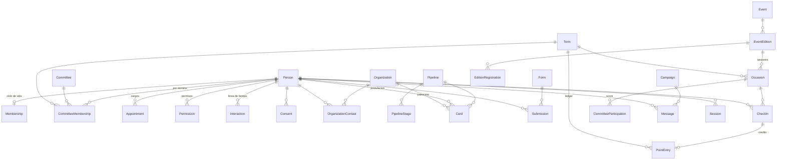

# Modelo de datos

PostgreSQL en Railway, Prisma con esquema por módulos (`prisma/schema/*.prisma`). Convenciones: ids `cuid2`; identificadores públicos `nanoid` solo donde se exponen en URL o QR; timestamps `timestamptz` en UTC; fechas de término como `date`; JSON parseado con Zod en la frontera de lectura; sin borrado físico de personas (anonimización).

## Diagrama

## Modelos por módulo

### identity

| Modelo | Campos clave | Notas |
| --- | --- | --- |
| `Session` | `personId`, `tokenHash` único, `expiresAt`, `userAgent`, `ip`, `lastSeenAt` | 90 días, renovable; se destruye al cambiar estado o correo |
| `OtpChallenge` | `email`, `codeHash`, `expiresAt`, `attempts`, `maxAttempts`, `consumedAt`, `ip` | 10 minutos, 5 intentos; rate limit contando filas |
| `Permission` | `personId`, `code` (`ADMIN`, `COMMITTEE_LEADER`), `committeeId?`, `grantedById` | Unique parcial por (persona, código, comité) |

### people

| Modelo | Campos clave | Notas |
| --- | --- | --- |
| `Person` | `email` único en minúsculas, `kind` (`STUDENT`, `EXTERNAL`), `stage`, `fullName`, `preferredName?`, `phone?`, `personalEmail?`, `program?`, `photoAssetId?`, `source` | Búsqueda con `pg_trgm` sobre nombre y correo; `personalEmail` es contacto (egresados y externos), nunca identidad de acceso |
| `Membership` | `personId` único, `status` (`ACTIVE`, `ON_LEAVE`, `HONORARY`, `INACTIVE`), `firstTermId`, `endedAt?`, `endReason?` | Una por persona |
| `MembershipEvent` | `membershipId`, `from`, `to`, `reason`, `actorId`, `at` | Historial de estados |
| `Committee` | `slug` único, `name`, `status`, `color`, `logoKey`, `presentation`, `contactUrl`, `publicationStatus` | Los 27 logos viven en `public/logos/committees` |
| `CommitteeMembership` | `personId`, `committeeId`, `termId`, `joinedAt?`, `leftAt?` | Unique por (persona, comité, término); 1 a 3 activas para vigentes |
| `Appointment` | `personId`, `kind` (`COMMITTEE_LEADER`, `BOARD`, `GH_COORDINATOR`, …), `committeeId?`, `termId`, `title?` | Cargo visible con historia |
| `Consent` | `personId`, `purpose`, `policyVersion`, `acceptedAt`, `source`, `ip?`, `revokedAt?` | Versionado |

### crm

| Modelo | Campos clave | Notas |
| --- | --- | --- |
| `Organization` | `name`, `kind`, `website?`, `notes?` | |
| `OrganizationContact` | `organizationId`, `personId`, `role`, `isPrimary` | Unique por (organización, persona) |
| `Pipeline` | `name`, `kind` (`ADMISSION`, `SPONSORSHIP`, `CUSTOM`), `isArchived` | |
| `PipelineStage` | `pipelineId`, `name`, `order`, `isWon`, `isLost` | |
| `Card` | `pipelineId`, `stageId`, `personId?`, `organizationId?`, `editionId?`, `ownerId?`, `title`, `fields` JSON, `amount?`, `dueAt?`, `enteredStageAt`, `closedAt?` | Exactamente uno de `personId` u `organizationId` |
| `Interaction` | `personId?`, `organizationId?`, `kind`, `occurredAt`, `actorId?`, `refType?`, `refId?`, `summary`, `body?`, `metadata` JSON, `editedAt?` | Automáticas inmutables; notas editables por su autor |
| `Task` | `title`, `assigneeId`, `dueAt?`, `status`, `personId?`, `organizationId?`, `cardId?`, `createdById` | |
| `Tag` / `PersonTag` / `OrganizationTag` | `name` único | |
| `Segment` | `name`, `filter` JSON, `createdById` | El filtro se valida con Zod al leer |

### forms

| Modelo | Campos clave | Notas |
| --- | --- | --- |
| `Form` | `slug` único, `title`, `description`, `fields` JSON, `audience` (`PUBLIC`, `MEMBERS`), `opensAt?`, `closesAt?`, `maxSubmissions?`, `consentRequired`, `actions` JSON | Acciones: `createProspect`, `pipelineId`, `editionId`, `tags` |
| `Submission` | `formId`, `personId?`, `email`, `answers` JSON, `consentAcceptedAt?`, `ip`, `userAgent` | Vincula persona por correo normalizado |
| `EditionRegistration` | `editionId`, `personId`, `status`, `submissionId?` | Unique por (edición, persona) |

### events

| Modelo | Campos clave | Notas |
| --- | --- | --- |
| `Event` | `slug` único, `name`, `summary`, `description`, `audience`, `publicationStatus`, `coverAssetId?` | Identidad permanente |
| `EventEdition` | `eventId`, `slug`, `name`, `startsAt`, `endsAt?`, `location`, `registrationUrl?`, `registrationFormId?`, `publicationStatus`, `coverAssetId?` | Unique por (evento, slug) |
| `EditionCommittee` | `editionId`, `committeeId` | Organizadores |

### participation

| Modelo | Campos clave | Notas |
| --- | --- | --- |
| `Term` | `code` único (`2026-2`), `semester` (1 o 2, derivado del código), `startsOn`, `endsOn`, `pointsClosedAt?`, `requiredOrdinaryAssemblies` (2) | El actual se deriva de la fecha; en los términos de segundo semestre la elección de junta es obligatoria |
| `Occasion` | `publicId` único, `termId`, `kind` (`ACTIVITY`, `ASSEMBLY`, `EDITION_SESSION`), `assemblyKind?` (`ORDINARY`, `BOARD_ELECTION`, `RUNOFF`; solo en asambleas), `title`, `startsAt`, `checkInOpensAt`, `checkInClosesAt`, `points`, `approval` (`AUTO`, `MANUAL`), `requireRotatingCode` (opcional por ocasión, apagado por defecto), `rotatingSecretHash?`, `committeeId?`, `editionId?`, `status`, `cancelReason?`, `createdById` | `DRAFT → OPEN → CLOSED`; `CANCELLED` desde cualquiera con motivo |
| `CheckIn` | `occasionId`, `personId`, `status` (`PENDING`, `APPROVED`, `REJECTED`, `CANCELLED`), `source` (`SELF_QR`, `HOST`, `ADMIN`, `IMPORT`), `at`, `decidedById?`, `decidedAt?`, `reason?` | Unique por (ocasión, persona) |
| `PointEntry` | `personId`, `termId`, `checkInId?`, `kind` (`CHECKIN`, `ADJUSTMENT`, `REVERSAL`, `LEGACY`), `points`, `reason`, `reversalOfId?` único, `createdById?`, `legacyType?` | Append-only |
| `CommitteeParticipation` | `occasionId`, `committeeId`, `termId`, `eligible`, `present`, `rate`, `smoothedRate`, `frozenAt?` | Unique por (ocasión, comité); cruda y suavizada con `k = 5` (ADR-024) |
| `TermStanding` | `termId` único, `topNew` JSON, `topVeteran` JSON, `topCommittees` JSON, `stats` JSON | Snapshot al cerrar puntos |
| `AssemblyRequirement` | `termId`, `personId`, `requiredOrdinary` (2), `requiresBoardElection`, `requiresRunoff`, `adjustedReason?`, `adjustedById?` | Unique por (término, persona); ajustes solo por ADMIN con motivo |

### content

| Modelo | Campos clave | Notas |
| --- | --- | --- |
| `Page` | `slug` único, `title`, `body` Markdown, `status`, `audience` | La OE, Unirse, Privacidad |
| `Announcement` | `title`, `body` Markdown, `audience`, `publishedAt?`, `pinned`, `pushSentAt?` | Cartelera |
| `MediaAsset` | `visibility` (`PUBLIC`, `PRIVATE`), `objectKey` único, `contentType`, `byteSize`, `width?`, `height?`, `variants` JSON, `uploadedById`, `status` (`PENDING`, `READY`) | Sin bytes en la base; un solo bucket privado, la visibilidad decide la caché al servir |
| `Document` | `title`, `kind` (`ESTATUTOS`, `REGLAMENTO`, `ACTA`, `OTRO`), `assetId`, `version`, `audience`, `articles` JSON opcional | Lector privado con búsqueda |

### comms

| Modelo | Campos clave | Notas |
| --- | --- | --- |
| `EmailTemplate` | `slug` único, `subject`, `body` Markdown con variables | |
| `Campaign` | `templateId`, `segmentId`, `status`, `scheduledAt?`, `sentCount`, `createdById` | Fan-out a `Message` por el scheduler |
| `Message` | `personId`, `channel` (`EMAIL`, `PUSH`), `campaignId?`, `subject`, `status`, `providerId?`, `error?`, `sentAt?` | Registro de todo envío |
| `PushSubscription` | `personId`, `endpoint` único, `keys` JSON, `userAgent`, `lastSeenAt` | |
| `NotificationPreference` | `personId` único, `emailCampaigns`, `pushAnnouncements`, `pushPoints`, `pushReminders` | |

### system

| Modelo | Campos clave | Notas |
| --- | --- | --- |
| `AuditLog` | `actorId?`, `action`, `entityType`, `entityId`, `before` JSON, `after` JSON, `ip?`, `legacy` | Misma transacción que la mutación |
| `AppConfig` | `key` único, `value`, `updatedById?` | `committees.min = 1`, `committees.max = 3`, `assemblies.requiredOrdinary = 2`, `score.shrinkK = 5`, `checkin.rotatingCodeDefault = false`, versión de la política |
| `Outbox` | `eventType`, `payload` JSON, `dedupeKey?`, `attempts`, `nextAttemptAt`, `processedAt?`, `deadLetterAt?`, `lastError?` | Un pendiente por `dedupeKey` |
| `ImportJob` | `type`, `status`, `filename`, `summary` JSON, `createdById` | Roster, migración |
| `LegacyAlias` | `path` único, `targetType`, `targetId` | `/a/{publicId}` y `/asamblea/{publicId}` de GHPOINTS |

## Restricciones que no negocia el esquema

Uniques parciales como migraciones SQL idempotentes (`CREATE UNIQUE INDEX IF NOT EXISTS`):

| Índice | Regla |
| --- | --- |
| `PointEntry(checkInId) WHERE kind = 'CHECKIN'` | Una entrada de crédito por check-in |
| `PointEntry(reversalOfId)` único | Una reversión por entrada |
| `Membership(personId)` único | Una membresía por persona |
| `Permission(personId, code) WHERE committeeId IS NULL` y `(personId, code, committeeId) WHERE committeeId IS NOT NULL` | Sin permisos duplicados |
| `CommitteeMembership(personId, committeeId, termId)` único | Una pertenencia por término |
| `CheckIn(occasionId, personId)` único | Un check-in por persona y ocasión |
| `Outbox(dedupeKey) WHERE processedAt IS NULL AND deadLetterAt IS NULL` | Un pendiente por clave |
| `LegacyAlias(path)` único | Un destino por ruta antigua |
| `Occasion(termId) WHERE assemblyKind = 'BOARD_ELECTION' AND status <> 'CANCELLED'` | Una elección de junta por término |
| `Card`: check `(personId IS NULL) <> (organizationId IS NULL)` | Un solo sujeto por tarjeta |

Reglas que viven en el dominio y se prueban en integración: tope de 3 comités por término para vigentes, `APPROVED ⇔ una entrada CHECKIN viva`, término derivado de la fecha, ledger cerrado tras `pointsClosedAt`, transiciones de etapa y de ocasión.
