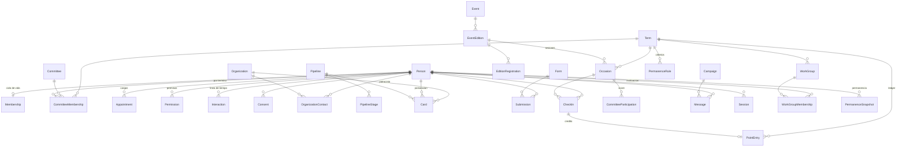

# Modelo de datos

PostgreSQL en Railway, Prisma con esquema por módulos (`prisma/schema/*.prisma`). Convenciones: ids `cuid2`; identificadores públicos `nanoid` solo donde se exponen en URL o QR; timestamps `timestamptz` en UTC; fechas de término como `date`; JSON parseado con Zod en la frontera de lectura; sin borrado físico de personas (anonimización).

## Diagrama

## Modelos por módulo

### identity

| Modelo | Campos clave | Notas |
| --- | --- | --- |
| `Session` | `personId`, `tokenHash` único, `expiresAt`, `userAgent`, `ip`, `lastSeenAt` | 90 días, renovable; se destruye al cambiar estado o correo |
| `OtpChallenge` | `email`, `codeHash`, `expiresAt`, `attempts`, `maxAttempts`, `consumedAt`, `ip` | 10 minutos, 5 intentos; rate limit contando filas |
| `Permission` | `personId`, `code` (`ADMIN`, `COMMITTEE_LEADER`), `committeeId?`, `grantedById` | Unique parcial por (persona, código, comité) |

### people

| Modelo | Campos clave | Notas |
| --- | --- | --- |
| `Person` | `email` único en minúsculas, `kind` (`STUDENT`, `EXTERNAL`), `stage`, `firstName`, `lastName`, `fullName` (compuesto), `preferredName?`, `phone?`, `personalEmail?`, `program?`, `photoAssetId?`, `source` | Búsqueda con `pg_trgm` sobre nombre y correo; `personalEmail` es contacto (egresados y externos), nunca identidad de acceso |
| `Membership` | `personId` único, `status` (`ACTIVE`, `ON_LEAVE`, `HONORARY`, `INACTIVE`), `firstTermId`, `endedAt?`, `endReason?` | Una por persona |
| `MembershipEvent` | `membershipId`, `from`, `to`, `reason`, `actorId`, `at` | Historial de estados |
| `Committee` | `slug` único, `name`, `status`, `color`, `logoKey`, `presentation`, `contactUrl`, `publicationStatus` | Los 27 logos viven en `public/logos/committees` |
| `CommitteeMembership` | `personId`, `committeeId`, `termId`, `roleCode` (`INTEGRANTE` por defecto), `transferredIn`, `joinedAt?`, `leftAt?` | Unique por (persona, comité, término); 1 a 3 activas para vigentes; `transferredIn` marca una transferencia interna (umbral 70 % en ese comité); un solo `GENERAL` por comité y término |
| `CommitteeRole` | `code` único, `label`, `isLeadership`, `order` | Catálogo: `GENERAL` (líder), `FINANCIERO`, `PUBLICIDAD`, `RELACIONES_PUBLICAS`, `LOGISTICA`, `GESTION_HUMANA` (GH confirmó que son esos seis) más `INTEGRANTE` por defecto; sigue siendo editable por si aparece otro |
| `MembershipTerm` | `personId`, `termId`, `probation`, `reason?`, `decidedById?` | Condición de la persona en el término: periodo de prueba (umbral 80 %) decidido en el cierre anterior |
| `Appointment` | `personId`, `kind` (`COMMITTEE_LEADER`, `PRESIDENT`, `VP_GH`, `VP_PUBLIC_RELATIONS`, `VP_ADMIN`, `VP_FINANCE`, `GH_HEAD`, `GH_DIRECTOR`, `BOARD`, …), `committeeId?`, `termId`, `title?` | Cargo visible con historia; los cargos de junta lideran los comités de trabajo y los de GH evalúan grupos |
| `Consent` | `personId`, `purpose`, `policyVersion`, `acceptedAt`, `source`, `ip?`, `revokedAt?` | Versionado |

### crm

| Modelo | Campos clave | Notas |
| --- | --- | --- |
| `Organization` | `name`, `kind`, `website?`, `notes?` | |
| `OrganizationContact` | `organizationId`, `personId`, `role`, `isPrimary` | Unique por (organización, persona) |
| `Pipeline` | `name`, `kind` (`ADMISSION`, `SPONSORSHIP`, `CUSTOM`), `isArchived` | |
| `PipelineStage` | `pipelineId`, `name`, `order`, `isWon`, `isLost` | |
| `Card` | `pipelineId`, `stageId`, `personId?`, `organizationId?`, `editionId?`, `ownerId?`, `title`, `fields` JSON, `amount?`, `dueAt?`, `enteredStageAt`, `closedAt?` | Exactamente uno de `personId` u `organizationId` |
| `Interaction` | `personId?`, `organizationId?`, `kind`, `occurredAt`, `actorId?`, `refType?`, `refId?`, `summary`, `body?`, `metadata` JSON, `editedAt?` | Automáticas inmutables; notas editables por su autor |
| `Task` | `title`, `assigneeId`, `dueAt?`, `status`, `personId?`, `organizationId?`, `cardId?`, `createdById` | |
| `Tag` / `PersonTag` / `OrganizationTag` | `name` único | |
| `Segment` | `name`, `filter` JSON, `createdById` | El filtro se valida con Zod al leer |

### forms

| Modelo | Campos clave | Notas |
| --- | --- | --- |
| `Form` | `slug` único, `title`, `description`, `fields` JSON, `audience` (`PUBLIC`, `MEMBERS`), `opensAt?`, `closesAt?`, `maxSubmissions?`, `consentRequired`, `actions` JSON | Acciones: `createProspect`, `pipelineId`, `editionId`, `tags` |
| `Submission` | `formId`, `personId?`, `email`, `answers` JSON, `consentAcceptedAt?`, `ip`, `userAgent` | Vincula persona por correo normalizado |
| `EditionRegistration` | `editionId`, `personId`, `status`, `submissionId?` | Unique por (edición, persona) |

### events

| Modelo | Campos clave | Notas |
| --- | --- | --- |
| `Event` | `slug` único, `name`, `summary`, `description`, `audience`, `publicationStatus`, `coverAssetId?` | Identidad permanente |
| `EventEdition` | `eventId`, `slug`, `name`, `startsAt`, `endsAt?`, `location`, `registrationUrl?`, `registrationFormId?`, `publicationStatus`, `coverAssetId?` | Unique por (evento, slug) |
| `EditionCommittee` | `editionId`, `committeeId` | Organizadores |

### participation

| Modelo | Campos clave | Notas |
| --- | --- | --- |
| `Term` | `code` único (`2026-2`), `semester` (1 o 2, derivado del código), `startsOn`, `endsOn`, `pointsClosedAt?`, `requiredOrdinaryAssemblies`, `permanenceGeneralNominal` (50), `permanenceCommitteeNominal` (60) | El actual se deriva de la fecha; en los términos de segundo semestre la elección de junta es obligatoria; los nominales solo sirven para avisar en el editor |
| `Occasion` | `publicId` único, `termId`, `kind` (`ACTIVITY`, `ASSEMBLY`, `EDITION_SESSION`), `assemblyKind?` (`ORDINARY`, `BOARD_ELECTION`, `RUNOFF`; solo en asambleas), `category` (`INTEGRATION`, `ATHLETIC_MATCH`, `COMMITTEE_MEETING`, `TALK`, `WORKSHOP`, `SOCIAL`, `OTHER`), `newMembersOnly`, `title`, `startsAt`, `checkInOpensAt`, `checkInClosesAt`, `points`, `approval` (`AUTO`, `MANUAL`), `requireRotatingCode` (opcional por ocasión, apagado por defecto), `rotatingSecretHash?`, `committeeId?`, `editionId?`, `status`, `cancelReason?`, `createdById` | `DRAFT → OPEN → CLOSED`; `CANCELLED` desde cualquiera con motivo |
| `CheckIn` | `occasionId`, `personId`, `status` (`PENDING`, `APPROVED`, `REJECTED`, `CANCELLED`), `source` (`SELF_QR`, `HOST`, `ADMIN`, `IMPORT`), `at`, `decidedById?`, `decidedAt?`, `reason?` | Unique por (ocasión, persona) |
| `PointEntry` | `personId`, `termId`, `checkInId?`, `kind` (`CHECKIN`, `ADJUSTMENT`, `REVERSAL`, `LEGACY`), `points`, `reason`, `reversalOfId?` único, `createdById?`, `legacyType?` | Append-only |
| `CommitteeParticipation` | `occasionId`, `committeeId`, `termId`, `eligible`, `present`, `rate`, `smoothedRate`, `frozenAt?` | Unique por (ocasión, comité); cruda y suavizada con `k = 5` (ADR-024) |
| `TermStanding` | `termId` único, `topNew` JSON, `topVeteran` JSON, `topCommittees` JSON, `stats` JSON | Snapshot al cerrar puntos |
| `AssemblyRequirement` | `termId`, `personId`, `requiredOrdinary` (1), `requiresBoardElection` (segundo semestre), `requiresRunoff`, `adjustedReason?`, `adjustedById?` | Unique por (término, persona); ajustes solo por ADMIN con motivo; faltar a una obligatoria propone salida de la OE en el cierre |

### permanence

| Modelo | Campos clave | Notas |
| --- | --- | --- |
| `PermanenceRule` | `termId`, `scope` (`GENERAL`, `COMMITTEE`), `committeeId?`, `key`, `label`, `description`, `weight`, `appliesTo` (`ALL`, `NEW`, `VETERAN`), `computation` (`CHECKIN_COUNT`, `CHECKIN_THRESHOLD`, `CHECKIN_RATE`, `GROUP_EVALUATED`, `COMPOSITE`, `LEADER_SCORE`, `MANUAL`), `params` JSON (incluye tramos por cantidad para GT), `order`, `lockedAt?` | Unique por (término, ámbito, comité, clave); el editor avisa si la tabla se aleja del valor nominal (50 general, 60 comité) sin bloquear |
| `LeaderScore` | `termId`, `personId`, `ruleId`, `value`, `note?`, `scoredById`, `scoredAt` | Para reglas `LEADER_SCORE`; nota obligatoria si el valor es menor al peso; escribe una interacción visible para la persona |
| `WorkGroup` | `termId`, `kind` (`WORK_COMMITTEE`, `GT_MACROEVENT`, `GAP`, `GAP_OE`, `BARRA_BRAVA`, `NEW_MEMBER_TASK`), `name`, `code?` (CAP, CGH, CCM, CAE, CML, CAF, ATHLETIC), `editionId?`, `eventId?`, `leaderPersonId?` | Los comités de trabajo son grupos, no `Committee`; el líder lo opera y los evaluadores de `WorkGroupEvaluator` evalúan al cerrar el semestre |
| `WorkGroupEvaluator` | `groupId`, `personId` | Director de GH del frente; GH principal para tareas de nuevos; capitán y DT para el Athletic; GH de turno para la barra brava |
| `WorkGroupMembership` | `groupId`, `personId`, `joinedAt`, `leftAt?`, `evaluation` (`PENDING`, `GOOD`, `INSUFFICIENT`), `evaluatedById?`, `evaluatedAt?`, `note?` | Unique por (grupo, persona); la evaluación escribe una interacción |
| `ManualCredit` | `termId`, `personId`, `ruleKey`, `value`, `reason`, `grantedById` | Para reglas `MANUAL`; auditado |
| `PermanenceSnapshot` | `termId`, `personId`, `generalTotal`, `results` JSON (por comité: parte del comité, total, umbral aplicable, `remainingPossible`, estado `EN_CAMINO`, `EN_RIESGO`, `NO_ALCANZA`, `CUMPLE`, `PRUEBA`, `NO_CUMPLE`), `mandatoryAssembliesMet`, `computedAt`, `frozenAt?` | Unique por (término, persona); recalculado por outbox; un resultado por comité, sin comité principal |
| `PermanenceDecision` | `termId`, `personId`, `committeeId?`, `proposed`, `decision` (`CONTINUES`, `PROBATION`, `EXIT_COMMITTEE`, `EXIT_OE`), `reason`, `decidedById`, `decidedAt` | Unique por (término, persona, comité); la app propone y ADMIN confirma; `EXIT_OE` ejecuta "dar de baja", `PROBATION` crea el `MembershipTerm` siguiente |

### content

| Modelo | Campos clave | Notas |
| --- | --- | --- |
| `Page` | `slug` único, `title`, `body` Markdown, `status`, `audience` | La OE, Unirse, Privacidad |
| `Announcement` | `title`, `body` Markdown, `audience`, `publishedAt?`, `pinned`, `pushSentAt?` | Cartelera |
| `MediaAsset` | `visibility` (`PUBLIC`, `PRIVATE`), `objectKey` único, `contentType`, `byteSize`, `width?`, `height?`, `variants` JSON, `uploadedById`, `status` (`PENDING`, `READY`) | Sin bytes en la base; un solo bucket privado, la visibilidad decide la caché al servir |
| `Document` | `title`, `kind` (`ESTATUTOS`, `REGLAMENTO`, `ACTA`, `OTRO`), `assetId`, `version`, `audience`, `articles` JSON opcional | Lector privado con búsqueda |

### comms

| Modelo | Campos clave | Notas |
| --- | --- | --- |
| `EmailTemplate` | `slug` único, `subject`, `body` Markdown con variables | |
| `Campaign` | `templateId`, `segmentId`, `status`, `scheduledAt?`, `sentCount`, `createdById` | Fan-out a `Message` por el scheduler |
| `Message` | `personId`, `channel` (`EMAIL`, `PUSH`), `campaignId?`, `subject`, `status`, `providerId?`, `error?`, `sentAt?` | Registro de todo envío |
| `PushSubscription` | `personId`, `endpoint` único, `keys` JSON, `userAgent`, `lastSeenAt` | |
| `NotificationPreference` | `personId` único, `emailCampaigns`, `pushAnnouncements`, `pushPoints`, `pushReminders` | |

### system

| Modelo | Campos clave | Notas |
| --- | --- | --- |
| `AuditLog` | `actorId?`, `action`, `entityType`, `entityId`, `before` JSON, `after` JSON, `ip?`, `legacy` | Misma transacción que la mutación |
| `AppConfig` | `key` único, `value`, `updatedById?` | `committees.min = 1`, `committees.max = 3`, `assemblies.requiredOrdinary = 1`, `permanence.assembliesForCredit = 3`, `score.shrinkK = 5`, `checkin.rotatingCodeDefault = false`, `permanence.threshold.active = 60`, `permanence.threshold.new = 80`, `permanence.threshold.probation = 80`, `permanence.threshold.transfer = 70`, `permanence.probationMargin = 10`, versión de la política |
| `Outbox` | `eventType`, `payload` JSON, `dedupeKey?`, `attempts`, `nextAttemptAt`, `processedAt?`, `deadLetterAt?`, `lastError?` | Un pendiente por `dedupeKey` |
| `ImportJob` | `type`, `status`, `filename`, `fileAssetId?`, `termId?`, `summary` JSON, `createdById` | Roster por término (formato en [13-importacion-del-roster.md](13-importacion-del-roster.md)), migración; el archivo original queda en el bucket privado |
| `LegacyAlias` | `path` único, `targetType`, `targetId` | `/a/{publicId}` y `/asamblea/{publicId}` de GHPOINTS |

## Restricciones que no negocia el esquema

Uniques parciales como migraciones SQL idempotentes (`CREATE UNIQUE INDEX IF NOT EXISTS`):

| Índice | Regla |
| --- | --- |
| `PointEntry(checkInId) WHERE kind = 'CHECKIN'` | Una entrada de crédito por check-in |
| `PointEntry(reversalOfId)` único | Una reversión por entrada |
| `Membership(personId)` único | Una membresía por persona |
| `Permission(personId, code) WHERE committeeId IS NULL` y `(personId, code, committeeId) WHERE committeeId IS NOT NULL` | Sin permisos duplicados |
| `CommitteeMembership(personId, committeeId, termId)` único | Una pertenencia por término |
| `CommitteeMembership(committeeId, termId) WHERE roleCode = 'GENERAL' AND leftAt IS NULL` | Un General por comité y término |
| `CheckIn(occasionId, personId)` único | Un check-in por persona y ocasión |
| `Outbox(dedupeKey) WHERE processedAt IS NULL AND deadLetterAt IS NULL` | Un pendiente por clave |
| `LegacyAlias(path)` único | Un destino por ruta antigua |
| `Occasion(termId) WHERE assemblyKind = 'BOARD_ELECTION' AND status <> 'CANCELLED'` | Una elección de junta por término |
| `Card`: check `(personId IS NULL) <> (organizationId IS NULL)` | Un solo sujeto por tarjeta |

Reglas que viven en el dominio y se prueban en integración: tope de 3 comités por término para vigentes, `APPROVED ⇔ una entrada CHECKIN viva`, término derivado de la fecha, ledger cerrado tras `pointsClosedAt`, transiciones de etapa y de ocasión.
