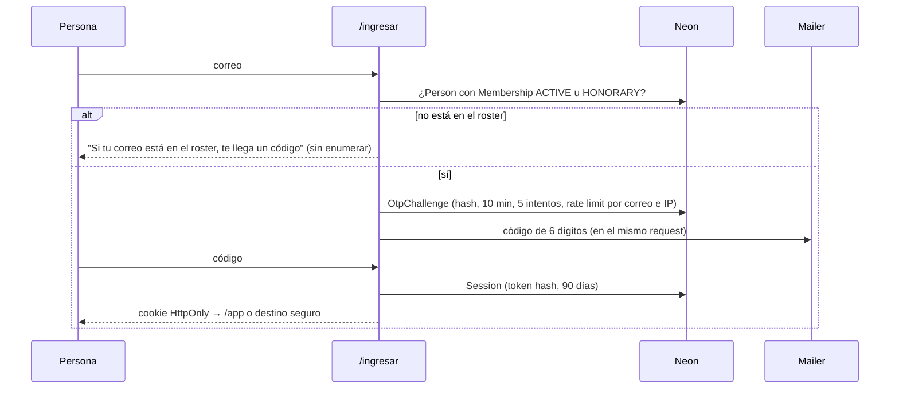

# Acceso e identidad

Solo entran las personas del roster: integrantes vigentes y honorarios. No hay registro abierto ni proveedor de identidad externo. La identidad es el correo institucional; el OTP verifica el buzón, que EAFIT ya protege con Microsoft 365. Reglas en [ADR-010](adr/ADR-010-identidad-por-correo-y-otp.md) y [ADR-011](adr/ADR-011-autorizacion-en-servidor.md).

## Flujo de ingreso

## Reglas

| Tema | Regla |
| --- | --- |
| Quién entra | `Membership.status` `ACTIVE` u `HONORARY`; licencia y retiro destruyen sesiones en la misma transacción |
| Dominio | `INSTITUTIONAL_EMAIL_DOMAINS` (`eafit.edu.co`); los contactos externos nunca inician sesión |
| OTP | 6 dígitos, `SHA-256(secreto:correo:código)`, 10 minutos, 5 intentos; máximo 5 solicitudes por correo y 12 por IP cada 15 minutos, contadas en Postgres |
| Respuesta | Siempre "si tu correo está en el roster, te llega un código": no se enumera el roster |
| Sesión | Token de 32 bytes, hash en base, cookie `HttpOnly` `SameSite=Lax` `Secure`; 90 días con "recordar este dispositivo", 24 horas sin marcarlo; se renueva al usarse |
| Destino | `next` solo acepta rutas same-origin y excluye `/ingresar` y `/api`; un ADMIN que entra a `/` va a `/admin` |
| Step-up | Conceder permisos, exportar datos personales y atender solicitudes de eliminación exigen un OTP verificado hace menos de 15 minutos |
| Sesiones | `/app/ajustes` lista dispositivos y permite cerrar los demás |
| Desarrollo | Sin `RESEND_API_KEY` el código se imprime en consola; `OTP_FIXED_CODE` solo fuera de producción |

## Autorización

- El proxy solo redirige `/app`, `/admin` y `/a/*` sin cookie hacia `/ingresar?next=…` y emite la CSP; nunca decide roles.
- `getActor()` (cacheado por request) devuelve `{ personId, nombre, membresía, permisos[] }` tras validar la sesión y el estado.
- Cada comando sensible empieza con `requireAdmin()` o `requireLeader(committeeId)`; los layouts hacen lo mismo para la UI.
- Permisos técnicos: `ADMIN` (todo), `COMMITTEE_LEADER` de uno o más comités (roster sin correo, score, proponer ocasiones en borrador, modo anfitrión en sus ocasiones). Los cargos visibles (`Appointment`) no otorgan permisos.
- No se puede retirar ni deshabilitar el último `ADMIN`.

## Modo anfitrión

Para días de evento con red mala o personas sin sesión: el organizador (líder o admin autenticado) abre la consola de la ocasión, busca a la persona por nombre o escanea el QR de su carnet y marca el check-in con `source=HOST`. El carnet (`/app/carnet`) es un QR con un token firmado (`personId`, vencimiento de 24 horas) que solo la consola sabe leer. Nadie queda bloqueado por no tener sesión en el celular.

## Código rotativo

Cuando una ocasión tiene `requireRotatingCode`, la consola muestra el QR con un código de 6 caracteres que cambia cada 60 segundos (derivado de un secreto por ocasión); el enlace estático `/a/[publicId]` sigue existiendo pero exige el código vigente. Evita que un QR reenviado por WhatsApp acredite a quien no está.

## Amenazas consideradas

| Amenaza | Mitigación |
| --- | --- |
| Enumerar el roster | Respuesta uniforme; sin diferencia de tiempo apreciable (el envío ocurre igual de rápido o no ocurre) |
| Fuerza bruta del OTP | 5 intentos por reto, retos con vencimiento, rate limit por correo e IP |
| Robo de cookie | HttpOnly, Secure, hash en base, cierre remoto, destrucción al cambiar estado |
| Redirect abierto | `next` validado como ruta same-origin |
| Admin comprometido | Step-up para lo sensible, auditoría de cada mutación, no retirar el último ADMIN |
| QR reenviado | Código rotativo y ventana de check-in corta; modo anfitrión para ocasiones grandes |
