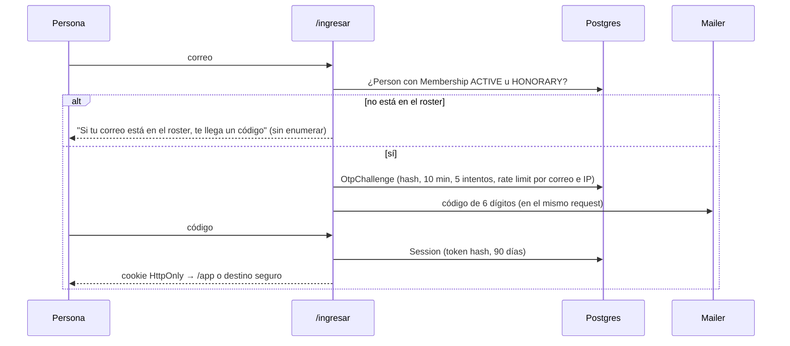

# Acceso e identidad

Solo entran las personas del roster: miembros activos y honorarios. No hay registro abierto ni proveedor de identidad externo. La identidad es el correo institucional; el OTP verifica el buzón, que EAFIT ya protege con Microsoft 365. Reglas en [ADR-010](adr/ADR-010-identidad-por-correo-y-otp.md) y [ADR-011](adr/ADR-011-autorizacion-en-servidor.md).

El primer ADMIN tiene una excepción puntual de arranque ([ADR-039](adr/ADR-039-arranque-limpio-fase-7.md)): script privado con identidad real, membresía ACTIVE y permiso ADMIN, sin crear consentimiento ni permitir registro abierto. Después de entrar por OTP, publica la política, activa su versión y carga el roster desde el asistente.

## Flujo de ingreso

## Reglas

| Tema | Regla |
| --- | --- |
| Quién entra | `Membership.status` `ACTIVE` u `HONORARY`; licencia, retiro y cambio de correo estampan `Person.sessionsRevokedAt` en la misma transacción y ninguna sesión anterior vuelve a resolver un actor; el outbox borra esas sesiones y revoca los permisos segundos después ([ADR-034](adr/ADR-034-personas-y-mi-oe-fase-2.md)). Los egresados no entran: su correo institucional suele caducar al graduarse ([ADR-024](adr/ADR-024-reglas-de-participacion.md)) |
| Dominio | `INSTITUTIONAL_EMAIL_DOMAINS` (`eafit.edu.co`); los contactos externos nunca inician sesión; "dar de alta" exige un correo institucional porque sin él la persona no podría entrar ([ADR-037](adr/ADR-037-admision-aliados-y-contactos-fase-5.md)) |
| OTP | 6 dígitos, `SHA-256(secreto:correo:código)`, 10 minutos, 5 intentos; máximo 5 solicitudes por correo y 12 por IP cada 15 minutos, contadas en Postgres |
| Respuesta | Siempre "si tu correo está en el roster, te llega un código": no se enumera el roster |
| Sesión | Token de 32 bytes, hash en base, cookie `HttpOnly` `SameSite=Lax` `Secure`; 90 días con "recordar este dispositivo", 24 horas sin marcarlo; se renueva al usarse |
| Destino | `next` solo acepta rutas same-origin y excluye `/ingresar` y `/api`; un ADMIN que entra a `/` va a `/admin` |
| Step-up | Conceder permisos, exportar datos personales, confirmar una importación del roster, anonimizar a una persona, cancelar una ocasión con créditos vivos, cerrar los puntos de un término y programar o enviar una campaña exigen un OTP verificado hace menos de 15 minutos ([ADR-035](adr/ADR-035-participacion-y-gh-points-fase-3.md), [ADR-038](adr/ADR-038-comunicaciones-y-pwa-fase-6.md)) |
| Push | `POST` y `DELETE /api/push/subscribe` exigen sesión y operan solo sobre las suscripciones del actor; las preferencias y la lista de dispositivos viven en `/app/ajustes`; sin claves VAPID el envío se imprime en consola ([ADR-038](adr/ADR-038-comunicaciones-y-pwa-fase-6.md)) |
| Tokens sin sesión | `/baja/[token]` y `POST /api/baja/[token]` solo apagan `emailCampaigns` de la persona del token; `GET /api/ics/mi-agenda.ics?t=…` devuelve la agenda propia (solo activos y honorarios, sin datos de terceros) y el token se regenera desde Ajustes; `/app/encuesta/[token]` exige sesión y que la invitación sea del actor ([ADR-038](adr/ADR-038-comunicaciones-y-pwa-fase-6.md)) |
| Billeteras | Emisión propia con actor `ACTIVE` u `HONORARY`; revocación propia y ADMIN de una persona desde la 360, auditada y sin step-up. `oe2` se resuelve en base con generación vigente; no concede acceso ni evita la elegibilidad del check-in ([ADR-040](adr/ADR-040-carnet-en-billeteras-fase-8.md)) |
| Check-in | `/a/[publicId]` exige sesión: sin cookie el proxy redirige a `/ingresar?next=…` (el código rotativo viaja en `?c=` dentro de `next`) y `/ingresar` muestra T-100; no hay check-in anónimo, la salida para quien no tiene sesión es el modo anfitrión |
| Foto propia | Un miembro sin ADMIN puede pedir un `POST` prefirmado solo para su foto (`purpose = "photo"`, privada, hasta 5 MB); la foto se muestra solo con consentimiento `DIRECTORY_PHOTO` y se sirve con sesión |
| Formularios públicos | `/f/[slug]` es la única ruta pública con escritura: honeypot (un campo oculto lleno responde el mismo "gracias" sin guardar), máximo 10 envíos por IP cada 15 minutos entre todos los formularios contados en `form_submission`, una respuesta por correo y formulario salvo que el formulario admita varias, tope de respuestas y ventana, y casilla de consentimiento obligatoria (T-154, propósito `DATA_PROCESSING`); un formulario de miembros exige sesión y toma la persona del actor ([ADR-037](adr/ADR-037-admision-aliados-y-contactos-fase-5.md)) |
| Solicitudes | Solo un miembro activo pide licencia, retiro o cambio de comité desde Mi OE; decide ADMIN (GH); una licencia o un retiro aprobados revocan las sesiones en la misma transacción y la respuesta llega por correo |
| Sesiones | `/app/ajustes` lista dispositivos y permite cerrar los demás |
| Desarrollo | Sin `RESEND_API_KEY` el código se imprime en consola; `OTP_FIXED_CODE` solo fuera de producción |

## Autorización

- El proxy solo redirige `/app`, `/admin` y `/a/*` sin cookie hacia `/ingresar?next=…` y emite la CSP; nunca decide roles.
- `getActor()` (cacheado por request) devuelve `{ personId, nombre, membresía, permisos[] }` tras validar la sesión y el estado.
- Cada acción sensible empieza con `assertAdmin(actor)`, `assertLeader(actor, committeeId)` o `assertBoard(actor)` en `src/app/**/actions.ts` o en la ruta API; los layouts hacen lo mismo para la UI. El layout del admin admite ADMIN, `COMMITTEE_LEADER`, `BOARD` y a quien lidere o evalúe un grupo de trabajo del término actual (roles derivados de `work_group`, compuestos en `src/app/admin/_kit/acceso.ts` porque `identity` no conoce los grupos), cada uno con la navegación recortada a lo suyo; cada página que no es de ese rol vuelve a exigir ADMIN ([ADR-036](adr/ADR-036-permanencia-fase-4.md)).
- Permisos técnicos: `ADMIN` (todo), `COMMITTEE_LEADER` de uno o más comités (roster sin correo, score, crear ocasiones de su comité y abrir solo las de 0 puntos, serie semanal de reuniones, consola y modo anfitrión de sus ocasiones; no aprueba pendientes ni ajusta puntos) y `BOARD` (panel de la junta y su exporte agregado). Los cargos visibles (`Appointment`, `GENERAL`) no otorgan permisos. Sí dan acceso, por datos y solo a lo suyo, el líder de un grupo de trabajo (opera sus miembros y, desde la fase 5, crea y decide las convocatorias internas de su grupo) y el evaluador de un grupo (bandeja de evaluaciones dentro de la ventana; ADMIN evalúa siempre). El líder de comité edita además la tabla de permanencia de su comité mientras GH no la bloquee y asigna los puntajes de su tabla. Exigen step-up: confirmar en bloque y aplicar el cierre de permanencia, además de los exportes con datos personales (desde la fase 5 también respuestas de formularios, inscritos y tarjetas con personas). "Dar de alta" a una persona no exige step-up: es una por vez, con auditoría; la importación masiva sí. Desde la fase 6 ([ADR-038](adr/ADR-038-comunicaciones-y-pwa-fase-6.md)) plantillas, campañas y el registro de mensajes exigen ADMIN; el resumen de la encuesta de una ocasión lo ven ADMIN y el líder de su comité; publicar un anuncio con push no exige step-up.
- No se puede retirar ni deshabilitar el último `ADMIN`.

## Modo anfitrión

Para días de evento con red mala o personas sin sesión: el organizador (líder o admin autenticado) abre el modo anfitrión de la ocasión (`/admin/ocasiones/[id]/anfitrion`), busca a la persona por nombre (sin ver correos) o escanea el QR de su carnet con la cámara del celular (`BarcodeDetector` nativo o `jsqr` como respaldo; el proxy emite `camera=(self)` solo en esa ruta) y marca el check-in con `source=HOST`, que nace aprobado aunque la ocasión sea de aprobación manual. El carnet (`/app/carnet`) es un QR con un token firmado que solo la consola sabe leer: `oe1.<personId>.<vencimiento en minutos unix>.<HMAC-SHA256 en base64url con SESSION_SECRET>`, vigente 24 horas, generado en el servidor como SVG (`signCarnet` y `verifyCarnet` en `identity`). Nadie queda bloqueado por no tener sesión en el celular.

El carnet de billetera añade `oe2.<token opaco>` persistente. `readCarnet` distingue formatos de manera asíncrona y devuelve `source` y vencimiento nulo para billeteras; un token desconocido, rotado o de otra generación responde `REVOKED` (T-1207). Baja y anonimización incrementan `membership.walletEpoch` antes del outbox; reactivar no rehabilita el pase. Revocar renueva únicamente el QR de las billeteras, no los tokens `oe1` ya emitidos ni las sesiones. El anfitrión necesita conexión para verificar `oe2`. Ver [ADR-040](adr/ADR-040-carnet-en-billeteras-fase-8.md).

## Código rotativo

Cuando una ocasión tiene `requireRotatingCode`, la consola muestra el QR con un código de **6 dígitos** que cambia cada 60 segundos: `HMAC-SHA256(secreto de la ocasión, "<occasionId>:<minuto unix>")` con truncamiento dinámico, como un TOTP; se aceptan la ventana actual y la anterior. El QR embebe el código (`/a/[publicId]?c=…`) y se redibuja cada minuto; el enlace estático sin código sigue existiendo pero exige el vigente. Evita que un QR reenviado por WhatsApp acredite a quien no está.

## Amenazas consideradas

| Amenaza | Mitigación |
| --- | --- |
| Enumerar el roster | Respuesta uniforme; sin diferencia de tiempo apreciable (el envío ocurre igual de rápido o no ocurre) |
| Fuerza bruta del OTP | 5 intentos por reto, retos con vencimiento, rate limit por correo e IP |
| Robo de cookie | HttpOnly, Secure, hash en base, cierre remoto, destrucción al cambiar estado |
| Redirect abierto | `next` validado como ruta same-origin |
| Admin comprometido | Step-up para lo sensible, auditoría de cada mutación, no retirar el último ADMIN |
| QR de billetera fotografiado o celular perdido | Rotar `oe2` invalida el anterior en servidor inmediatamente; Google recibe el QR nuevo en el mismo objeto y Apple se vuelve a agregar. El anfitrión coteja el nombre. No equivale a cerrar sesiones ni retirar la cuenta que ya guardó el objeto. Baja/anonimización invalidan generaciones antiguas aun si luego se reactiva (ADR-040) |
| QR reenviado | Código rotativo y ventana de check-in corta; modo anfitrión para ocasiones grandes |
| Spam en formularios públicos | Honeypot, rate limit por IP contado en Postgres, una respuesta por correo, tope y ventana por formulario; Cloudflare delante solo si aparece spam real ([ADR-023](adr/ADR-023-operacion-entornos-respaldo-correo.md)) |
