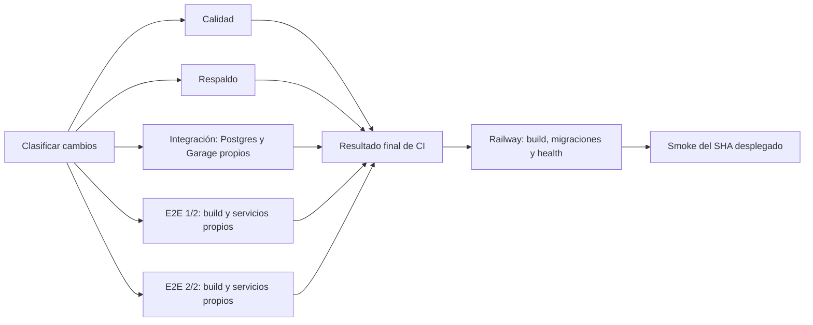

# Evaluación de CI/CD · 2026-09-11

**El pipeline puede mejorar sustancialmente sin quitar pruebas.** La mediana reciente es **16 min 42 s**. El camino que determina su duración encadena integración, build, instalación de Chromium y todos los E2E en una sola máquina. Separar integración y distribuir E2E entre dos máquinas permite plantear un **objetivo inicial de 10–12 minutos**. Es una estimación pendiente de medir en GitHub; un objetivo posterior de 8–10 minutos requiere comprobar el balance y la caché.

Este documento entrega el assessment y una propuesta concreta. No modifica el workflow, las reglas de GitHub ni la configuración de Railway. Las correcciones locales de la suite de [ADR-052](adr/ADR-052-aislamiento-y-fallos-de-las-pruebas-e2e.md) siguen sin publicarse: las ejecuciones remotas medidas tienen 184 E2E; la suite local actual tiene 169. No se atribuye a GitHub una aceleración medida en el equipo local.

La [evidencia estructurada](assessment-ci-cd-2026-09-11.json) conserva las ejecuciones, pasos, configuración consultada, particiones y comprobaciones. Las propuestas no constituyen una nueva decisión arquitectónica aceptada; su implementación deberá registrar la ADR correspondiente.

## Medición y alcance

Se listaron 121 ejecuciones del workflow CI y se desglosaron sus **30 ejecuciones más recientes**, entre el 8 de septiembre a las 20:55 UTC y el 11 a las 04:40 UTC. Hubo **21 éxitos, 8 cancelaciones y 1 fallo**, todos en el primer intento de ejecución. Los percentiles excluyen cancelaciones, fallos y otros workflows, como la actualización del grafo de dependencias.

La duración se calcula desde `run_started_at` hasta el último `job.completed_at`, incluyendo espera inicial y limpieza. Se distingue de la publicación posterior del estado del workflow. El p90 usa el rango más cercano.

| Medida de las 21 ejecuciones exitosas | Resultado |
| --- | ---: |
| Mediana de CI completo | 16:42 |
| p90 de CI completo | 17:18 |
| Mínimo / máximo | 13:38 / 17:58 |
| Mediana de espera hasta el primer job | 0:04 |
| Mediana del job de calidad | 2:29 |
| Mediana del job de integración + E2E | 16:20 |
| Mediana del job de respaldo | 0:41 |

La cola inicial es pequeña frente al tiempo de ejecución. Las ocho cancelaciones sumaron **86,4 minutos de ejecución de runners**, contando todos sus jobs; son duración observada, no minutos facturados. `cancel-in-progress` ya evita que una ejecución anterior siga completa cuando llega otra a la misma referencia. La muestra no permite atribuir todas las cancelaciones a esa opción.

La [última ejecución, 34563110173](https://github.com/Mateoloperaortiz/LaOE/actions/runs/34563110173), corresponde al SHA `f7546c2`, un cambio de roadmap y runbook. Su desglose es especialmente claro:

| Paso del job que termina último | Última ejecución | Mediana de las 21 exitosas |
| --- | ---: | ---: |
| Integración | 3:32 | 3:03 |
| Build para E2E | 1:08 | 1:06 |
| Instalar Chromium y dependencias del sistema | 0:33 | 0:28 |
| E2E | 11:49 | 10:53 |
| Resto del job: servicios, checkout, npm, preparación y limpieza | 0:52 | — |
| **Job completo** | **17:54** | **16:20** |

E2E e integración suman **15:21**, aproximadamente el 86 % del job. Calidad terminó en 1:36 y respaldo en 0:40, en paralelo. Optimizar esos dos jobs apenas cambiaría el tiempo de espera del usuario.

Los logs de integración registran 304 casos en 64 archivos: 131,29 s de pruebas y 68,49 s de importaciones, dentro de 211,61 s totales. El archivo más lento fue `normativa-import.test.ts`, con 19,706 s y cuatro casos que ejecutan el CLI real. No hay evidencia para quitar esas comprobaciones por su duración. Separarlas de E2E elimina primero su efecto sobre el camino crítico sin alterar su comportamiento.

La ejecución exitosa registró 184 E2E aprobados, sin casos flaky reportados. El único fallo de la muestra fue una aserción del menú en `admin-responsive.spec.ts`: esperaba 38 enlaces y obtuvo 39, también en el reintento. El reintento no resolvió ese fallo determinista. La configuración publicada todavía admite un reintento; la local ya usa cero.

## Cuánto añade Railway

Se consultaron los servicios y los últimos 50 deployments de web, la configuración efectiva de ambos entornos y los logs de build/health de los dos deployments actualmente exitosos. Staging sigue `main`; producción sigue `production`; ambos tienen `checkSuites: true`, migraciones previas y healthcheck. La configuración consultada no tenía cambios pendientes.

| Deployment | Primer log de build | Health aprobado | CI → estado SUCCESS de Railway |
| --- | --- | --- | ---: |
| Staging, `83ea96a3…`, SHA `f7546c2` | 04:58:52 UTC | 05:00:10 UTC | ~1:16 |
| Producción, `b19cad09…`, SHA `0da910c` | 00:21:35 UTC | 00:23:05 UTC | ~1:29 |

Las fases registradas de build y health abarcaron aproximadamente 78 y 90 segundos. Los primeros logs preceden unos segundos a la finalización administrativa de los jobs de Actions; por eso no se suman esos intervalos como si fueran completamente consecutivos. Desde la creación del deployment hasta SUCCESS fueron **19:14 en staging** y **18:30 en producción**, principalmente esperando CI.

El healthcheck aprobó al primer intento en ambos casos. El timeout configurado de 300 s es un máximo, no una espera fija. Reducirlo no aceleraría estos despliegues. Tampoco hay evidencia en esta muestra que justifique aumentar la capacidad de web para reducir CI, que corre en máquinas de GitHub. Railway documenta que su espera de CI mantiene el deployment pendiente hasta que las comprobaciones terminan. [Wait for CI](https://docs.railway.com/deployments/github-autodeploys#wait-for-ci).

Para deployments retirados, `updatedAt` puede corresponder a su reemplazo. No se usó ese campo para estimar cuánto tardaron en arrancar.

## Propuesta priorizada

| Orden | Cambio propuesto | Efecto esperado | Condición para aceptarlo |
| --- | --- | --- | --- |
| 1 | Publicar la suite corregida y guardar duración por prueba en cada CI | Establece una base fiable para optimizar | Cero fallos ocultos del outbox, cero reintentos, inventario completo |
| 2 | Separar integración y E2E en jobs paralelos | Retira unos 3–3,5 min del camino crítico actual | Cada job conserva su Postgres y Garage independientes |
| 3 | Dos particiones E2E por casos, con un worker por máquina | Objetivo inicial de CI completo: 10–12 min | Todas las pruebas presentes; ambas particiones aprobadas |
| 4 | Tratar de forma ligera los cambios documentales confirmados y filtrar autodeploys | Evita CI completo y despliegues de documentación | Analizar el rango completo del cambio; conservar un resultado final explícito |
| 5 | Persistir `.next/cache` | Ahorro adicional dentro del build de ~1 min | Comparar caché fría/caliente y conservar build de producción |
| 6 | Smoke automático después del deployment exitoso | Acorta la comprobación manual y detecta fallos de entrega | Verificar SHA y entorno exactos, en un workflow posterior |
| 7 | Evaluar reutilizar CI aprobado del mismo SHA al promover | Evitar otra ejecución de ~16–17 min por promoción | Evidencia de CI completo y confiable del SHA exacto; fallback a CI completo |

### Separar los jobs y repartir E2E

La topología propuesta conserva calidad y respaldo en paralelo, añade un job independiente de integración y usa una matriz de dos jobs E2E. Cada partición recibe su propio runner, Postgres, Garage, servidor, archivos de autenticación y base desechable. Subir workers dentro de la máquina actual entraría en conflicto con la restauración compartida de la base; se conserva `workers: 1`.



Se comprobó la partición nativa de Playwright antes de recomendarla. Repartir por archivos da 92/75 escenarios y aproximadamente **69/31 del trabajo** registrado localmente. Repartir por casos da 84/83 y aproximadamente **60/40**. El equilibrio del número de casos no garantiza igualdad de duración. Playwright permite ambas granularidades y recomienda un worker por máquina en CI; los servicios externos a cada prueba requieren aislamiento propio. [Sharding](https://playwright.dev/docs/test-sharding), [CI de Playwright](https://playwright.dev/docs/ci).

Los comandos candidatos se ejecutaron **secuencialmente en local**, sobre el build y `next start`, con bases desechables independientes:

```sh
CI=true npm run test:e2e -- --fully-parallel --shard=1/2 --workers=1 --forbid-only
CI=true npm run test:e2e -- --fully-parallel --shard=2/2 --workers=1 --forbid-only
```

| Partición por casos | Escenarios | Autenticación | Resultado | Tiempo de Playwright |
| --- | ---: | ---: | --- | ---: |
| 1/2 | 84 | 2 | 86 aprobadas | 2:24 |
| 2/2 | 83 | 2 | 85 aprobadas | 1:39 |

Ambos comandos terminaron con código 0, sin saltos, reintentos, flaky ni fallos inesperados del outbox. La unión cubre exactamente los **167 escenarios actuales**, sin solapamiento; las dos preparaciones de autenticación se repiten por máquina. Por eso hay 171 ejecuciones para los 169 casos únicos de la suite. Esta comprobación acredita que las particiones funcionan independientemente, no el tiempo que tardarán dos runners de GitHub en paralelo.

En el workflow, la matriz sería `shard: [1, 2]`, con `fail-fast: false`. El comando usaría `--shard=${{ matrix.shard }}/2 --fully-parallel --workers=1 --forbid-only`. Los informes deben tener nombres distintos por partición. El resultado final debe exigir el éxito de ambas y verificar el inventario; un reporte ausente o un job inesperadamente omitido debe fallar. La opción `--fully-parallel` distribuye los casos entre las particiones; `--workers=1` mantiene la ejecución de un solo caso a la vez dentro de cada runner.

Modelo aproximado usando el último CI remoto:

| Variante | Cálculo orientativo | Duración modelada |
| --- | --- | ---: |
| Actual | Medida | 17:58 |
| Integración independiente | 1.078 − 212 s | 14:26 |
| Además, dos particiones por archivos | 157 s de preparación + 69 % de 709 s E2E | 10:45 |
| Además, dos particiones por casos | 157 s + 60 % de 709 s E2E | 9:43 |
| Reparto ideal de dos mitades | 157 s + 709 / 2 s | 8:32 |

Los porcentajes proceden de la suite local nueva y los segundos de la suite remota anterior: el modelo solo orienta. Hay que añadir nuevas colas, autenticación repetida, clasificación e informes. De ahí el objetivo inicial prudente de **10–12 min**, pendiente de observar. La duplicación de servicios y preparación puede aumentar los minutos totales de runner aunque reduzca la espera. Se deben medir ambas cosas.

### Cambios documentales y despliegues innecesarios

Los commits `f7546c2` y `59bd708` solo cambiaron roadmap/runbook y ejecutaron CI completo durante 17:58 y 17:11, además de desplegar staging. Web no tiene `watchPatterns`; el servicio backup sí tiene filtros para sus propios archivos.

La propuesta inicial es reconocer únicamente rutas documentales comprobadas, como `docs/09-roadmap.md`, `docs/15-runbook.md` y `docs/adr/**`. Todo archivo desconocido ejecuta la validación completa. `docs/14-copy-y-textos.md` requiere especial atención: alimenta `scripts/copy-sync.ts` y el copy generado de la aplicación. Un filtro genérico para todos los Markdown sería demasiado amplio.

Para CI, conviene clasificar dentro del workflow y emitir siempre un resultado final. Omitir el workflow entero mediante `paths-ignore` puede dejar comprobaciones requeridas pendientes. El resultado final, ejecutado también tras fallos, debe comprobar explícitamente los resultados de sus dependencias; `always()` por sí solo no acredita éxito. [Workflows omitidos](https://docs.github.com/en/actions/how-tos/manage-workflow-runs/skip-workflow-runs), [Dependencias entre jobs](https://docs.github.com/en/actions/how-tos/write-workflows/choose-what-workflows-do/use-jobs).

Para web, se propone introducir las exclusiones documentales confirmadas en `build.watchPatterns` de `.railway/railway.ts`, conservando incluidos por defecto los demás archivos. Railway admite patrones y negaciones precedidas por una inclusión. Primero se debe comprobar en staging el comportamiento de pushes de varios commits y promociones; una promoción puede contener código pendiente aunque su último commit sea documental. Para CI, el clasificador debe comparar todo el rango de push o de PR, y ante un diff incompleto ejecutar todo. [Watch paths de Railway](https://docs.railway.com/builds/build-configuration#configure-watch-paths).

### Caché y compilaciones

El log de Next confirma que CI no encuentra caché de build. Se propone persistir **`.next/cache`**, con clave de plataforma, Node, lockfile, configuración relevante y fuentes, y una clave de restauración compatible para cambios de código. La caché de npm ya está habilitada: en la última ejecución `npm ci` tardó 8 s en calidad y 13 s en integración/E2E. La principal oportunidad de caché está en Next. [Guía oficial de Next.js](https://nextjs.org/docs/app/guides/ci-build-caching).

Hay dos compilaciones de Next en CI y otra en Railway. El build de calidad corre en paralelo y tarda 42 s en el último CI: retirarlo ahorraría cómputo, pero casi no reduciría la duración total. Se puede evaluar consolidarlo cuando otro job garantice siempre el build requerido. Compartir una compilación completa entre entornos exige controlar las variables incorporadas durante el build; la propuesta inicial conserva builds propios y solo comparte caché compatible.

La instalación de Chromium tarda decenas de segundos. Su caché no es la primera medida: Playwright advierte que restaurar los binarios puede costar tanto como descargarlos y que las dependencias del sistema siguen necesitando instalación. [Caché de navegadores](https://playwright.dev/docs/ci#caching-browsers).

### Promoción y comprobación posterior

La muestra contiene cuatro promociones completas que volvieron a ejecutar CI sobre el mismo SHA ya aprobado en `main`: `0da910c`, `7f95c8b`, `242a08a` y `2a0cf6b`. Reutilizar esa evidencia podría acortar la promoción. Requiere comprobar el SHA exacto, workflow confiable, suite completa, resultado final y contexto compatible; un simple «último main verde» o un CI documental no bastan. Debe existir fallback a CI completo. Se propone como una segunda etapa, conservando Wait for CI mientras se diseña y prueba esa validación.

`scripts/smoke.ts` y su biblioteca ya verifican la entrega; el runbook exige ejecutarlos a mano. Railway publica estados de deployment en GitHub: se comprobó el evento `success` del deployment `6386583107`, con su SHA y entorno. Eso permite proponer un workflow posterior por `deployment_status`, limitado a éxito y a los entornos conocidos, que ejecute el smoke con SHA y expectativas de ese entorno.

Ese smoke debe estar separado del CI que Railway espera: esperar el deployment desde el mismo CI crearía una dependencia circular. Su resultado verifica la entrega y debe quedar visible; no revierte automáticamente migraciones ni datos.

## Fiabilidad que debe acompañar la mejora

Los rulesets de `main` y `production` están activos, pero solo impiden borrados y avances forzados. No requieren actualmente un check de CI; tampoco hay protección clásica adicional. Railway sí espera CI para desplegar. Al introducir el resultado final estable, se propone exigir ese check en las ramas, coordinándolo con la promoción manual documentada.

La configuración de Playwright no activa `forbidOnly`. Los comandos de partición ensayados sí usan `--forbid-only`; debe quedar exigido en CI para que una prueba enfocada accidentalmente no reduzca la suite. Las correcciones del outbox, el calendario y el aislamiento de ADR-052 deben llegar antes de usar las particiones en GitHub.

El workflow solo sube artefactos cuando falla y el reporter de GitHub no conserva tiempos individuales suficientes de los casos aprobados. Se propone guardar siempre un resumen JSON de duraciones, conteos, reintentos y estado del outbox; las trazas pesadas pueden seguir limitadas a fallos. Así se podrá distinguir una regresión concreta de un runner más lento. El pendiente R4 sobre cierres anticipados del stream sigue documentado en la auditoría de pruebas; no se considera resuelto por acelerar CI.

## Criterios de cierre de una implementación

1. Comparar la suite corregida sin cambios de pipeline con la misma suite tras cada optimización; recoger al menos diez ejecuciones completas y distinguir caché fría/caliente.
2. Mantener todas las familias: calidad, unitarias, extractor Python, integración, E2E y respaldo. Verificar la unión exacta de casos por partición, sin omisiones inesperadas ni reintentos.
3. Comprobar que un handler fallido, una partición fallida, un informe ausente y una prueba enfocada impiden el resultado final satisfactorio.
4. Ensayar documentación sola, código, migraciones, copy, cambios mixtos, archivos nuevos, push de varios commits y promoción con código pendiente. Ante incertidumbre del clasificador, ejecutar todo.
5. Medir mediana, p90, colas, partición más lenta, minutos de runner y tiempo desde push hasta health/smoke del SHA esperado. Aceptar el objetivo de 10–12 min solo con evidencia remota.
6. Mantener migraciones previas, healthcheck, aislamiento de entornos y comprobación del SHA desplegado. Registrar la decisión y el rollout en la ADR y el roadmap.

La validación realizada para este assessment fue de lectura de GitHub/Railway, análisis del código/configuración, enumeración de ambas estrategias y ejecución local de las dos particiones por casos. `npm run lint` y `git diff --check` terminaron aprobados; se verificaron los enlaces locales, las métricas y la unión de casos del JSON, y no quedaron bases E2E desechables. La configuración operativa permanece como estaba; los cambios de esta entrega son el informe, la evidencia y su seguimiento documental.
